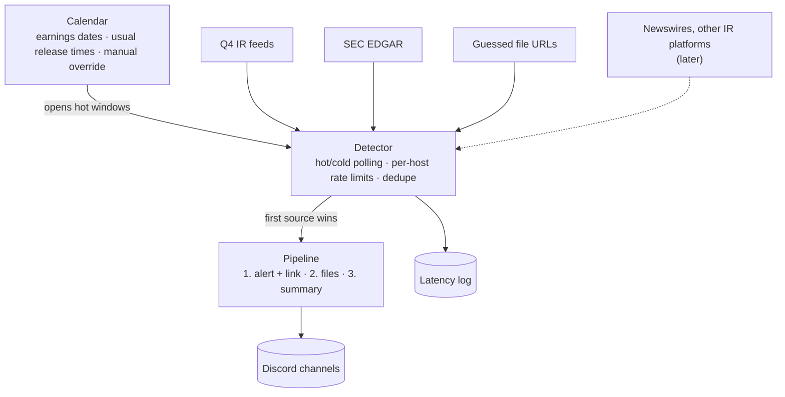

# Architecture

This is a living document. Sections marked **Open** haven't been decided yet.

## Goal

Post a company's earnings to Discord before anyone else does, then follow up with the release
files and a formatted summary of the numbers.

## Overview

## Release detection

### What we measured

Data pulled on 2026-10-30, covering up to nine quarters per company:

- **IR release time:** the publish time in the company's investor relations (IR) feed
- **8-K accepted:** SEC EDGAR's acceptance timestamp
- **File upload time:** the `Last-Modified` header of the release PDF on the IR site's file CDN

| Ticker | IR platform | Fastest source | 8-K accepted after IR release | Release PDF uploaded after IR release |
|---|---|---|---|---|
| AMZN | Q4 | IR site (9/9 quarters) | median 12m17s (4m27s–24m12s) | 2m42s–13m36s |
| GOOGL | Q4 | IR site (5/5) | median 36s (33s–48s) | 56s–1m12s |
| MA | Q4 | IR site (9/9) | median 3m09s (1m49s–4m03s) | 23s–2m07s |
| UBER | Q4 | IR site (8/8) | median 1m12s (52s–1m58s) | 17s–29s |
| META | Q4 | IR site (9/9) | median 3m34s (2m23s–11m00s) | 8m12s–29m28s |
| SPGI | Q4 for the investor site; releases go out through a PR Newswire newsroom | SEC 8-K (9/9) | 8-K comes **5m38s–14m40s before** the IR site | 48s–6m29s *before* the IR site, but still after the 8-K |
| FICO | Not Q4; the site rejects automated requests | SEC 8-K (the only source we can reach) | n/a | n/a (file URLs are random IDs) |

What this tells us:

- **The IR site is usually first**, often by minutes. EDGAR itself is fast (the submissions API
  updates about a second after a filing is published), but companies file the 8-K after the
  press release is out.
- **Not always.** S&P Global's 8-K beats its own IR site every quarter. We have to run every
  source and take whichever fires first.
- **Release PDFs usually go up after the release page.** So guessing file URLs mostly helps us
  collect files sooner, and only sometimes detects a release first.
- For comparison, Wall St Engine's full posts came 2m14s (AMZN), 4m25s (MA) and 6m35s (GOOGL)
  after the IR release in Q3 2026.

### Sources

1. **Q4 IR feeds.** The main source for companies whose IR site runs on Q4 Inc. Q4 sites expose
   undocumented JSON feeds under `/feed/`:
   - `PressRelease.svc/GetPressReleaseList`: detects the release
   - `Event.svc/GetEventList`: earnings call dates (for the calendar) and attached files
   - `FinancialReport.svc/GetFinancialReportList`: the release, slides, supplemental data and 10-Q for each quarter

   Feed timestamps use each site's local time zone, and that isn't consistent even within one
   site. We use our own clock.
2. **SEC EDGAR.** The fallback for every company and the main source when the IR site is slow or
   unreachable (SPGI, FICO). We poll `data.sec.gov/submissions/CIK##########.json` for new 8-Ks
   with item 2.02. SEC allows at most 10 requests per second across everything we send it, and
   requires a User-Agent with a name and contact email (`SEC_USER_AGENT` in `.env`).
3. **Guessed file URLs.** File names follow per-company patterns that we learn from past
   quarters, for example:
   - `AMZN-Q{q}-{yyyy}-Earnings-Release.pdf`
   - `Uber-Q{q}-{yy}-Earnings-Press-Release.pdf`
   - `{yyyy}q{q}-alphabet-earnings-release.pdf`

   During a hot window we probe the likely URLs with `HEAD` requests. When a pattern has varied
   in the past (Meta's `_FINAL` vs `-FINAL`, Mastercard's folder change) we probe each variant.
   The file CDN doesn't cache 404s, so probing before a file exists can't leave a stale copy.
4. **Later:** newswire RSS feeds (PR Newswire's feed accepted automated reads and was current;
   Business Wire's accepted them but its newest item was hours old) and adapters for other IR
   platforms.

### Scheduling

- **Calendar.** Earnings dates come from the Q4 events feed, or from EDGAR and manual entry for
  other companies. Each company's past release times tell us when in the day to look: Amazon has
  used 4:01:00 PM ET for nine straight quarters, and Uber 6:55:00 AM ET.
- **Hot window.** Starts a few minutes before the expected release and runs until the release is
  detected or the window times out. Each source is polled about once a second. IR feeds get a
  cache-busting query parameter, because their CDN can otherwise serve a copy up to 10 seconds
  old. We cap this at one request per second per company.
- **Cold polling.** Outside hot windows, every source is polled every few minutes to catch
  unscheduled or early releases.
- **Rate limits are per host and shared across companies.** On a busy evening, a dozen companies
  report at 4 PM and all of them share SEC's 10 requests per second.
- **Connections stay open** (HTTP keep-alive / HTTP/2), so polls don't pay for a new TLS
  handshake.

### From detection to Discord

- The first source to fire triggers the pipeline. Later sources are merged into the same
  release by (ticker, fiscal period) and only add what's missing, such as more files.
- Posting happens in stages: an alert with a link within seconds, then files as they appear,
  then the summary.
- Every source records when it first saw each release. This latency log shows which source
  wins for each company and lets us compare against public timestamps such as X posts.

### Adding a company

`/track TICKER` looks up the CIK in SEC's `company_tickers.json`, checks whether the IR site runs
on Q4, learns file name patterns from past quarters, and starts tracking right away. There's no
approval step.

### Ground rules

- Identify ourselves honestly in the User-Agent. Stay within the rate limits, and back off when we
  get errors.
- If a site blocks automated requests (FICO's IR site does), cover it through EDGAR and newswires.
  We don't try to get around the block.

## Summary generation

**Open.** Where consensus estimates come from, how numbers are pulled out of releases, which
KPIs matter for each company, and how the post is laid out in Discord.

## Hosting and storage

**Open.** Where the bot runs (it should sit close to US East for latency) and what it stores
(tracked companies, seen releases, latency log).

## Decision log

| Date | Decision |
|---|---|
| 2026-10-29 | Python 3.13 with discord.py; uv, ruff, pyright and pytest; CI on GitHub Actions; Docker image on GHCR |
| 2026-10-30 | Run every source in parallel and take the first to fire. Q4 IR feeds are the main source, with SEC EDGAR as the fallback for every company |
| 2026-10-30 | Bust the CDN cache on IR feeds during hot windows, at most one request per second per company |
| 2026-10-30 | Add guessed file URLs as a source, probed during hot windows |
| 2026-10-30 | `/track` adds companies without an approval step |
| 2026-10-30 | Each deployment sets its own SEC contact through `SEC_USER_AGENT` |
