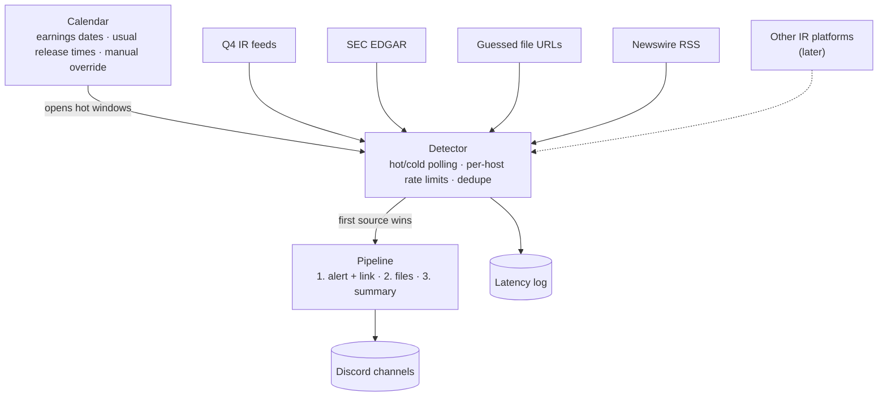

# Architecture

This is a living document. Sections marked **Open** haven't been decided yet.

## Goal

Post a company's earnings to Discord before anyone else does, then follow up with the release
files and a formatted summary of the numbers.

## Overview

## Release detection

### What we measured

Data pulled on 2026-10-30, covering up to nine quarters per company:

- **IR release time:** the publish time in the company's investor relations (IR) feed
- **8-K accepted:** SEC EDGAR's acceptance timestamp
- **File upload time:** the `Last-Modified` header of the release PDF on the IR site's file CDN

| Ticker | IR platform | Fastest source | 8-K accepted after IR release | Release PDF uploaded after IR release |
|---|---|---|---|---|
| AMZN | Q4 | IR site (9/9 quarters) | median 12m17s (4m27s–24m12s) | 2m42s–13m36s |
| GOOGL | Q4 | IR site (5/5) | median 36s (33s–48s) | 56s–1m12s |
| MA | Q4 | IR site (9/9) | median 3m09s (1m49s–4m03s) | 23s–2m07s |
| UBER | Q4 | IR site (8/8) | median 1m12s (52s–1m58s) | 17s–29s |
| META | Q4 | IR site (9/9) | median 3m34s (2m23s–11m00s) | 8m12s–29m28s |
| SPGI | Q4 for the investor site; releases go out through a PR Newswire newsroom | SEC 8-K (9/9) | 8-K comes **5m38s–14m40s before** the IR site | 48s–6m29s *before* the IR site, but still after the 8-K |
| FICO | Not Q4; the site blocks automated access | Business Wire, which publishes at 4:15:00 PM ET | median 1m13s after the 4:15 PM release (26s–4m45s) | n/a (file URLs are random IDs on the blocked site) |

What this tells us:

- **The IR site is usually first**, often by minutes. EDGAR itself is fast (the submissions API
  updates about a second after a filing is published), but companies file the 8-K after the
  press release is out.
- **Not always.** S&P Global's 8-K beats its own IR site every quarter. We have to run every
  source and take whichever fires first.
- **The newswire is as fast as the IR site.** Business Wire's earnings feed lists Amazon's Q3
  release at 4:01:00 PM ET, the same minute as the IR feed. For FICO, whose IR site we can't
  reach, the newswire is the fastest source.
- **Release PDFs usually go up after the release page.** So guessing file URLs mostly helps us
  collect files sooner, and only sometimes detects a release first.
- For comparison, Wall St Engine's full posts came 2m14s (AMZN), 4m25s (MA) and 6m35s (GOOGL)
  after the IR release in Q3 2026.

### Sources

1. **Q4 IR feeds.** The main source for companies whose IR site runs on Q4 Inc. Q4 sites expose
   undocumented JSON feeds under `/feed/`:
   - `PressRelease.svc/GetPressReleaseList`: detects the release
   - `Event.svc/GetEventList`: earnings call dates (for the calendar) and attached files
   - `FinancialReport.svc/GetFinancialReportList`: the release, slides, supplemental data and 10-Q for each quarter

   Feed timestamps use each site's local time zone, and that isn't consistent even within one
   site. We use our own clock.
2. **SEC EDGAR.** The fallback for every company, and the main source for S&P Global, whose IR
   site trails its 8-K. We poll `data.sec.gov/submissions/CIK##########.json` for new 8-Ks
   with item 2.02. SEC allows at most 10 requests per second across everything we send it, and
   requires a User-Agent with a name and contact email (`SEC_USER_AGENT` in `.env`).
3. **Guessed file URLs.** File names follow per-company patterns that we learn from past
   quarters, for example:
   - `AMZN-Q{q}-{yyyy}-Earnings-Release.pdf`
   - `Uber-Q{q}-{yy}-Earnings-Press-Release.pdf`
   - `{yyyy}q{q}-alphabet-earnings-release.pdf`

   During a hot window we probe the likely URLs with `HEAD` requests. When a pattern has varied
   in the past (Meta's `_FINAL` vs `-FINAL`, Mastercard's folder change) we probe each variant.
   The file CDN doesn't cache 404s, so probing before a file exists can't leave a stale copy.
4. **Newswire RSS.** Business Wire's Earnings News feed
   (`https://feed.businesswire.com/rss/home/?rss=G1QFDERJXkJeEF9YXA==`) carries about 220
   releases a day, and each `pubDate` is the release minute. We match items to tracked companies
   by name. It's the main source for FICO. The feed allows caching for up to 5 minutes
   (`s-maxage=300`), so how quickly it refreshes still needs measuring. PR Newswire has a similar
   feed (`https://www.prnewswire.com/rss/news-releases-list.rss`) for companies that use it,
   such as S&P Global.
   The same source reads company press release feeds, such as the ones Equisolve sites publish.
5. **Later:** adapters for other IR platforms.

### IR platforms

How often is a company's IR site something other than Q4? We checked 36 widely followed
companies on 2026-10-30, plus the seven above, by probing the Q4 feed and reading each site's
DNS records:

| Platform | Companies | Automated access |
|---|---|---|
| Q4 | AAPL, NVDA, NFLX, ORCL, CRM, PLTR, COIN, V, PYPL, COST, SBUX, BA, ABNB, SNOW, MU, QCOM, plus AMZN, GOOGL, MA, META, UBER, SPGI | JSON feeds work |
| Equisolve | AMD, INTC, BAC, WMT, KO, NKE | Pages load, and each site has a press release RSS feed at `/news-events/press-releases/rss` |
| Notified (`*.gcs-web.com`) | FICO, CRWD, LLY | Blocked by Akamai (403) |
| Investis | HD | Blocked (403) |
| The company's own site | MSFT, ADBE, GS, JPM, UNH, TGT | Pages load, with no common feed |
| Unknown, blocked | TSLA, AVGO, MCD, DIS | 403 or timeout |

- **Q4 is about half** (22 of 43), so it stays the first IR adapter.
- **Equisolve is next**, and its RSS feeds already work with the newswire source.
- **About one in five sites block automated access** (8 of 43). Those companies are covered by
  newswires and EDGAR, the way FICO is.

### Scheduling

- **Calendar.** Earnings dates come from the Q4 events feed, or from EDGAR and manual entry for
  other companies. Each company's past release times tell us when in the day to look: Amazon has
  used 4:01:00 PM ET for nine straight quarters, Uber 6:55:00 AM ET, and FICO 4:15:00 PM ET.
- **Hot window.** Starts a few minutes before the expected release and runs until the release is
  detected or the window times out. Each source is polled about once a second, and once every
  few seconds for newswire RSS, which serves every company from one URL. IR feeds get a
  cache-busting query parameter, because their CDN can otherwise serve a copy up to 10 seconds
  old. We cap this at one request per second per company.
- **Cold polling.** Outside hot windows, every source is polled every few minutes to catch
  unscheduled or early releases.
- **Rate limits are per host and shared across companies.** On a busy evening, a dozen companies
  report at 4 PM and all of them share SEC's 10 requests per second.
- **Connections stay open** (HTTP keep-alive / HTTP/2), so polls don't pay for a new TLS
  handshake.

### From detection to Discord

- The first source to fire triggers the pipeline. Later sources are merged into the same
  release by (ticker, fiscal period) and only add what's missing, such as more files.
- Posting happens in stages: an alert with a link within seconds, then files as they appear,
  then the summary.
- Each step logs two times after the first sighting. `live_seconds` comes from Discord's own
  timestamp on the message or edit, which is when people could see it. `seconds` is when
  Discord's reply reached the bot. They differ when discord.py waits out a rate limit before
  returning. In tests on 2026-10-30, Discord answered every request in 0.1 to 0.6 seconds, and
  every multi-second wait came from discord.py's rate limiter: about 4 seconds on reads, once a
  bucket ran out. In one replay, Discord stamped the alert 0.12 seconds after the sighting, but
  the reply reached the bot only at 2.54 seconds.
- Every source records when it first saw each release. This latency log shows which source
  wins for each company and lets us compare against public timestamps such as X posts.
- Until the detector exists, `earnings-bot-record` takes the same measurements for scheduled
  releases. It polls every source during a window around the expected time. The first run is
  November 4, 2026: Uber at 6:55 AM ET and FICO at 4:15 PM ET.

### Adding a company

`/track TICKER` looks up the CIK in SEC's `company_tickers.json`, checks whether the IR site runs
on Q4, learns file name patterns from past quarters, and starts tracking right away. There's no
approval step.

### Ground rules

- Identify ourselves honestly in the User-Agent. Stay within the rate limits, and back off when we
  get errors.
- If a site blocks automated requests, cover it through EDGAR and newswires. We don't try to get
  around the block, whether by faking a browser User-Agent or by scripting a real browser.
  FICO's IR site is behind Akamai bot protection, and even its `robots.txt` returns 403.

## Posting and summaries

One Discord message per release, edited as more arrives:

1. **Alert.** The first source to show the release triggers a post with its link and the time
   it was first seen. Later sources add their links.
2. **Files.** Release PDFs (guessed URLs, the IR site's file list) are downloaded and attached.
3. **Summary.** The first source that can supply the full text starts the summary, which is
   edited in as an embed (up to 4,096 characters, against 2,000 for plain text).

Where the text comes from:

| Source | Text | Notes |
|---|---|---|
| Q4 press release feed | The full release HTML, from the same feed with `bodyType=1` | Ready the moment the release is detected |
| SEC 8-K | The press release exhibit (EX-99.1), found through the filing's `index.json` | About a minute later for most companies; at the same time for Apple |
| Guessed or newsroom pages | The page itself | Apple's newsroom |
| Business Wire | None | Its article pages drop automated requests |

The summary comes from Claude (`claude-opus-5-5`, effort `medium`). It gets the release text,
consensus EPS and revenue from Financial Modeling Prep's earnings calendar, and a style guide
written for this project, with a made-up example rather than copies of anyone's posts. Claude
picks the KPIs that matter for each company. The bot then checks every number in the summary
against the release, allowing for rounding and for tables stated in thousands or millions, and
lists any it can't find in the embed's footer.

**Open.** Estimates for KPIs beyond EPS and revenue, and how fast the summary can get without
losing accuracy (effort `low`, or a smaller model).

## Hosting and storage

**Open.** Where the bot runs (it should sit close to US East for latency) and what it stores
(tracked companies, seen releases, latency log).

## Decision log

| Date | Decision |
|---|---|
| 2026-10-29 | Python 3.13 with discord.py; uv, ruff, pyright and pytest; CI on GitHub Actions; Docker image on GHCR |
| 2026-10-30 | Run every source in parallel and take the first to fire. Q4 IR feeds are the main source, with SEC EDGAR as the fallback for every company |
| 2026-10-30 | Bust the CDN cache on IR feeds during hot windows, at most one request per second per company |
| 2026-10-30 | Add guessed file URLs as a source, probed during hot windows |
| 2026-10-30 | `/track` adds companies without an approval step |
| 2026-10-30 | Each deployment sets its own SEC contact through `SEC_USER_AGENT` |
| 2026-10-30 | Add newswire RSS as a source (Business Wire's earnings feed first). It's the main source for FICO, whose IR site blocks automated access |
| 2026-10-30 | Measure every source live with a latency recorder before building the detector, starting with Uber and FICO on 2026-11-04 |
| 2026-10-30 | Post one message per release and edit it: alert with links, then files, then the summary as an embed |
| 2026-10-30 | Write summaries with the Claude API (`claude-opus-5-5`) and check their numbers against the release. Consensus estimates come from Financial Modeling Prep |
| 2026-10-30 | Until `/track` exists, the bot watches the releases in a schedule file, the same format the latency recorder uses |
