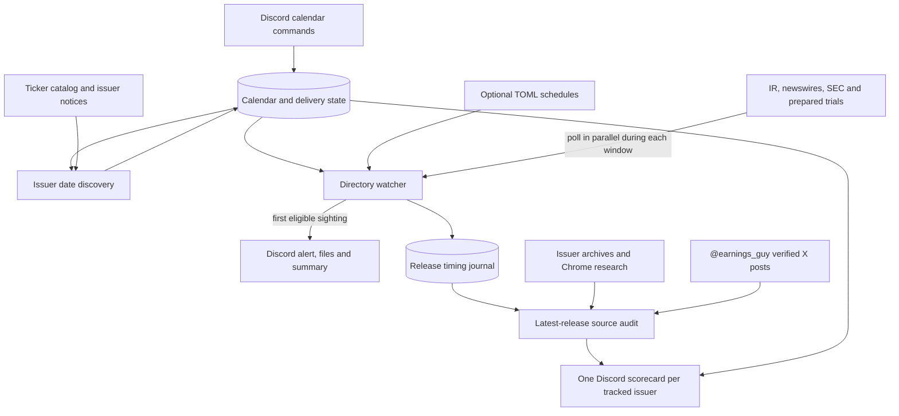

# Architecture

The overview, scheduling, tracking and unattended sections describe the current implementation.
The dated measurements and decision log record the research that led to it. See the
[calendar guide](unattended.md) for commands and operator steps.

## Goal

Post a company's earnings to Discord as soon as a source makes them available. Follow up with its
release files and a formatted summary of the numbers.

## Overview

## Release detection

### What we measured

Data pulled on 2026-10-30, covering up to nine quarters per company:

- **IR release time:** the publish time in the company's investor relations (IR) feed
- **8-K accepted:** SEC EDGAR's acceptance timestamp
- **File upload time:** the `Last-Modified` header of the release PDF on the IR site's file CDN

| Ticker | IR platform | Fastest source | 8-K accepted after IR release | Release PDF uploaded after IR release |
|---|---|---|---|---|
| AMZN | Q4 | IR site (9/9 quarters) | median 12m17s (4m27s–24m12s) | 2m42s–13m36s |
| GOOGL | Q4 | IR site (5/5) | median 36s (33s–48s) | 56s–1m12s |
| MA | Q4 | IR site (9/9) | median 3m09s (1m49s–4m03s) | 23s–2m07s |
| UBER | Q4 | IR site (8/8) | median 1m12s (52s–1m58s) | 17s–29s |
| META | Q4 | IR site (9/9) | median 3m34s (2m23s–11m00s) | 8m12s–29m28s |
| SPGI | Q4 for the investor site; releases go out through a PR Newswire newsroom | SEC 8-K (9/9) | 8-K comes **5m38s–14m40s before** the IR site | 48s–6m29s *before* the IR site, but still after the 8-K |
| FICO | Not Q4; the site blocks automated access | Business Wire, which publishes at 4:15:00 PM ET | median 1m13s after the 4:15 PM release (26s–4m45s) | n/a (file URLs are random IDs on the blocked site) |

What this tells us:

- **The IR site is usually first**, often by minutes. EDGAR itself is fast (the submissions API
  updates about a second after a filing is published), but companies file the 8-K after the
  press release is out.
- **Not always.** S&P Global's 8-K beats its own IR site every quarter. We have to run every
  source and take whichever fires first.
- **The newswire is stamped as fast as the IR site.** Business Wire's earnings feed lists Amazon's
  Q3 release at 4:01:00 PM ET, the same minute as the IR feed. But the free feed only shows a
  release at its next rebuild, up to about 5 minutes later (measured on Nov 4, see
  [Live runs](#live-runs)). For FICO, whose IR site we can't reach, the 8-K can come first.
- **Release PDFs usually go up after the release page.** So guessing file URLs mostly helps us
  collect files sooner, and only sometimes detects a release first.
- For comparison, Wall St Engine's full posts came 2m14s (AMZN), 4m25s (MA) and 6m35s (GOOGL)
  after the IR release in Q3 2026.

### Sources

1. **Q4 IR feeds.** The main source for companies whose IR site runs on Q4 Inc. Q4 sites expose
   undocumented JSON feeds under `/feed/`:
   - `PressRelease.svc/GetPressReleaseList`: detects the release
   - `Event.svc/GetEventList`: earnings call dates and attached files, useful for research
   - `FinancialReport.svc/GetFinancialReportList`: the release, slides, supplemental data and 10-Q for each quarter

   Feed timestamps use each site's local time zone, and that isn't consistent even within one
   site. We use our own clock.
2. **SEC EDGAR.** The fallback for every company, and the main source for S&P Global, whose IR
   site trails its 8-K. We poll two lists of the company's filings for new 8-Ks with item 2.02:
   - EDGAR's latest-filings feed, narrowed to the company
     (`/cgi-bin/browse-edgar?action=getcurrent&CIK=...&type=8-K&output=atom`). It lists a
     filing the moment it goes public, together with its folder, and is never cached.
   - The submissions JSON (`data.sec.gov/submissions/CIK##########.json`). It lagged the feed
     by 0 to 56 seconds for six 8-Ks measured on 2026-11-03, and by 48 seconds for AMD's. It
     stays as a backup: the feed is a slower, generated page, and one request to it took over
     20 seconds during that evening's rush. Between 4 and 4:45 PM on Nov 4, about 2% of
     requests to it took more than 10 seconds, while the submissions JSON never failed. Slow
     answers do come (after 7 and 12 seconds in a test that evening, against a median of 0.09
     seconds), and asking again is quicker. So every poll gives up after 3 seconds and the next
     one goes out at once. As a backup it's polled every 3 s, the feed every second.

   New 8-Ks reached the feed 19 to 35 seconds after SEC accepted them (15 filings on Nov 3;
   HubSpot's and FICO's took 28 and 35 seconds on Nov 4).

   Both point to the same filing folder. The alert gets one SEC link and the release pipeline
   shares a successful exhibit read across both sightings. SEC allows at most 10
   requests per second across everything we send it, and requires a User-Agent with a name and
   contact email (`SEC_USER_AGENT` in `.env`).
3. **Guessed file URLs.** File names follow per-company patterns that we learn from past
   quarters, for example:
   - `AMZN-Q{q}-{yyyy}-Earnings-Release.pdf`
   - `Uber-Q{q}-{yy}-Earnings-Press-Release.pdf`
   - `{yyyy}q{q}-alphabet-earnings-release.pdf`

   During a hot window we probe the likely URLs with `HEAD` requests. When a pattern has varied
   in the past (Meta's `_FINAL` vs `-FINAL`, Mastercard's folder change) we probe each variant.
   The file CDN doesn't cache 404s, so probing before a file exists can't leave a stale copy.
4. **Newswire RSS.** Business Wire's Earnings News feed
   (`https://feed.businesswire.com/rss/home/?rss=G1QFDERJXkJeEF9YXA==`) carries about 220
   releases a day, and each `pubDate` is the release minute. We match items to tracked companies
   by name. It's a main source for FICO and HubSpot. Business Wire rebuilds the feed about every
   4.5 minutes, and a release only appears at the next rebuild, so it reaches us anywhere from
   a few seconds to about 5 minutes after its stamp. Its CDN can then keep a copy for up to 5 more
   minutes (`s-maxage=300`), so we only poll a cache-busted copy. PR Newswire's earnings
   feed (`https://www.prnewswire.com/rss/financial-services-latest-news/earnings-list.rss`) is
   read the same way for companies that use it: a schedule entry lists their names under
   `prnewswire`. Its items also name the company in `dc:contributor`, which is matched too.
   The same source reads company press release feeds, such as the ones Equisolve sites publish.
5. **Sources on trial.** Found on Nov 6, 2026, each answering the bot's normal User-Agent. A
   schedule lists them in a `[target.trial]` table. They're polled and logged like any other
   source, but what they see only posts to Discord when the table says `post = true`, which
   waits until release days show they're right and fast. Until then the summary marks them
   `trial`.
   - **Broadcom's newsroom JSON** (`www.broadcom.com/api/news/newsroom`): every financial
     release, newest first, with its UTC time. It's about 150 KB and takes no paging
     parameters. Cloudflare served a copy 445 s old despite `no-cache`, so it's busted. A
     release's text comes from `/api/getmetadata`, which answers 200 with a stub that has no
     `body` for an ID it doesn't know yet.
   - **GlobeNewswire's earnings RSS** (`rss.globenewswire.com/RssFeed/subjectcode/13`, 20 items).
     Its article pages on `www.globenewswire.com` still answer 403, but the RSS host lets us in
     and names the company in `dc:contributor`. It's cached for 60 s. A cache-buster reaches the
     server, but on Nov 6 that server returned the same build as the cached copy, so both copies
     are polled until a live release shows whether busting helps. For NVIDIA and AMD.
   - **PR Newswire's Semiconductors feed**, a second PR Newswire feed with its own 60-second
     timer that carries Broadcom's releases.
   - **Company feeds:** HubSpot's `ir.hubspot.com/rss/news-releases.xml`, whose CDN allows a
     copy to be kept for 30 days (`s-maxage=2592000`), so it's busted like every company feed.
   - **Release pages fetched whole**, on hosts with plain 404s and small 404 pages:
     CrowdStrike's copy on FinancialContent (`markets.financialcontent.com`), McDonald's
     MediaRoom newsroom (`mcdonalds.mediaroom.com`) and Airbnb's newsroom (`news.airbnb.com`).
     Each poll is a `GET`, so the poll that finds the page already has the release's text. A
     page counts as found only if it's HTML, or for a `.pdf` URL, if it starts with `%PDF-`.
     McDonald's origin sometimes takes 11 to 16 s to answer. Polls still give up after 3 s,
     and the summary counts timeouts apart from other errors so that stays visible.

6. **Desktop Chrome IR trials.** Selected issuer listings can run in stock Chrome on a separate
   inactive Windows desktop. A file can opt into a listing, exact PDF candidates, or the separate
   Tesla HTTP deck trial. For tracked issuers, the planner can prepare a record-only listing
   after verifying the previous quarter's article. See [browser IR](browser-ir.md).

### IR platforms

How often is a company's IR site something other than Q4? We checked 36 widely followed
companies on 2026-10-30, plus the seven above, by probing the Q4 feed and reading each site's
DNS records:

| Platform | Companies | Automated access |
|---|---|---|
| Q4 | AAPL, NVDA, NFLX, ORCL, CRM, PLTR, COIN, V, PYPL, COST, SBUX, BA, ABNB, SNOW, MU, QCOM, DIS, plus AMZN, GOOGL, MA, META, UBER, SPGI | JSON feeds work |
| Equisolve | AMD, INTC, BAC, WMT, KO, NKE | Pages load. AMD, Intel, Coca-Cola and Nike have a press release RSS feed at `/news-events/press-releases/rss`; Walmart and Bank of America don't |
| Notified (`*.gcs-web.com`) | FICO, CRWD, LLY | Blocked by Akamai (403) |
| Investis | HD | Blocked (403) |
| The company's own site | MSFT, ADBE, GS, JPM, UNH, TGT | Pages load, with no common feed |
| Unknown, blocked | TSLA, AVGO, MCD | 403 or timeout |

- **Q4 is about half** (23 of the 42 in the table), so it stays the first IR adapter. Disney
  was first counted as blocked, because `thewaltdisneycompany.com/investor-relations/` returns
  403. Its IR site is really `investors.thewaltdisneycompany.com`, on Q4, which works.
- **Equisolve is next**, and its RSS feeds already work with the newswire source.
- **About one in six sites block automated access** (7 of 42). Those companies are covered by
  newswires and EDGAR, the way FICO is.

### Companies off Q4

Checked on 2026-10-31 for the 19 companies in the table that aren't on Q4, plus S&P Global.
HubSpot was added on 2026-11-04. Each row gives the fastest source we can read and how far it led the 8-K. Where a range is
given, the source's time held for the quarters we could see. A single number comes from the
latest quarter only. The details per company, with the last four 8-K times, are in
`src/earnings_bot/companies.toml`.

| Fastest source we can read | Companies | Lead over the 8-K |
|---|---|---|
| The company's RSS feed (Equisolve) | AMD 4:15 PM, Intel 4:01 PM, Coca-Cola 6:55 AM, Nike 4:15 PM | AMD 1 min, Intel 6–10 min, Coca-Cola 3–5 min, Nike only 15–28 s |
| PR Newswire | Lilly 6:45 AM, Home Depot 6:00 AM, Target 6:30 AM, McDonald's 7:00 AM, Broadcom 4:15 PM | Lilly 18 min, Home Depot 10 min, Target 81 min, McDonald's 1.5 min, Broadcom 11 min (Q3 FY26, by its newsroom's time) |
| A company page at a predictable URL | UnitedHealth 5:55 AM, with Business Wire the same minute | 19 min |
| Business Wire | FICO 4:15 PM, Adobe 4:05 PM, CrowdStrike 4:05 PM, HubSpot 4:05 PM | FICO median 1m13s, Adobe 1 min, CrowdStrike 2 min, HubSpot 10 min |
| SEC 8-K | S&P Global, Walmart, JPMorgan, Bank of America, Tesla | S&P Global's 8-K beats PR Newswire by 6–11 min. Walmart's beats its own newsroom by about a minute and Business Wire by two. JPMorgan's beats Business Wire by 38 min |
| Not known yet | Microsoft, Goldman Sachs | |

- **Which wire a company uses varies, and it isn't always Business Wire.** AMD and NVIDIA use
  GlobeNewswire, whose site returns 403 to us, so their own feeds are the way in. Its RSS host
  does answer us (found Nov 6), so its earnings feed is on trial. Lilly, Home Depot, Target,
  McDonald's, S&P Global and Broadcom use PR Newswire; Broadcom's releases were missed on Oct 31
  and found on Nov 6, filed as "Broadcom Inc.". UnitedHealth, Salesforce, Walmart, JPMorgan,
  Adobe, CrowdStrike and HubSpot use Business Wire. Bank of America, Goldman Sachs, Microsoft and
  Tesla use none.
- **Business Wire's free feed shows a release up to about 5 minutes after its stamp,** at the
  feed's next rebuild. So the Business Wire row's lead over the 8-K shrinks by that much. On
  Nov 4 it was still first for HubSpot (8-K 5 minutes after the release) but not for FICO (8-K
  39 seconds after).
- **A wire can trail the 8-K badly.** JPMorgan's 8-K was accepted at 6:30 AM, and Business
  Wire posted its release at 7:08 AM. Its release PDF was uploaded at 5:15 AM under a random
  name. The quarterly-earnings page that links it answers us, so watching that page might beat
  the 8-K.
- **Release files on blocked sites mostly come after the wire.** By their `Last-Modified`
  stamps, Lilly's PDF went up 2 minutes after PR Newswire, Home Depot's 5 minutes after it, and
  CrowdStrike's 2 minutes after its 8-K. McDonald's is the exception: its PDF was uploaded at
  6:46 AM, 14 minutes before the 7:00 AM release, while the default client received HTTP 403.
- **PR Newswire is a source,** for Lilly, Home Depot, Target, McDonald's and S&P Global. Its
  earnings feed holds the latest 20 earnings releases, so it's polled every 2 seconds: twenty
  items can turn over within a minute at 4 PM on a busy day. Its CDN keeps a copy for up to 60
  seconds and ignores cache-busting parameters (a fresh URL came back as a cache hit 38 seconds
  old), so there's no busted copy to poll. Live data will show how much of that minute it costs.
- **Some own sites have predictable URLs** for the release page or PDF: UnitedHealth, Target,
  Walmart, Goldman Sachs and Microsoft. These are guess templates in `companies.toml`. Others
  name files by random IDs: JPMorgan, Bank of America, and Walmart's PDFs.
- **Tesla's update deck** has a predictable URL. The default HTTP client gets 403, so the
  8-K is the regular source. The [IR trial](browser-ir.md) can also watch the deck URL
  with a Tesla-specific User-Agent that identifies earnings-bot.
- **Issuer IR sources on trial.** The [desktop Chrome trial](browser-ir.md) covers the
  release listings for FICO, CrowdStrike, HubSpot, Lilly and Broadcom, plus exact PDF URLs
  for Home Depot and McDonald's. CrowdStrike's copy on FinancialContent, McDonald's
  MediaRoom newsroom, Broadcom's newsroom API and HubSpot's release feed are independent
  trials (see [Sources](#sources)). The [manual checks](manual-checks.md) document earlier
  release times.

### How fresh feeds are

Every company feed we read stamps the release with its release minute: AMD 4:15:00 PM, Intel
4:01:00 PM, Coca-Cola 6:55:00 AM, Nike 4:15:00 PM and Target 6:30 AM. That's the same minute as
the wire and the release page. But a stamp is the time the release was scheduled for, not proof
the item was in the feed at that second. How stale a copy can be depends on caching.

On 2026-10-31 we sent each feed three requests: a plain one, one with a cache-busting query
parameter, and one with `Cache-Control: no-cache`. A slower answer, a `MISS`, or no `age` means
the request reached the origin:

| Feed | Caching | Does busting reach the origin? |
|---|---|---|
| Q4 JSON feeds | 10 s | Yes on Oct 31. No by Nov 5: busted requests to five Q4 sites (Airbnb, Atlassian, Cloudflare, Amazon, Uber) were all `HIT`s. On Nov 6 the cache key counted only the feed's own parameters: `_=`, `cb=`, `zzz=` and `no-cache` all got the shared copy, but `pageSize=6` got its own |
| Business Wire RSS | 300 s at the CDN | Yes: the busted request took 389 ms against 101 ms. But the origin only rebuilds the feed about every 4.5 minutes (Nov 4) |
| PR Newswire RSS | 60 s (Cloudflare) | No: busted and `no-cache` requests were both cache hits, 47 s old |
| Intel's RSS feed | 30 s plus stale-while-revalidate (CloudFront) | No, and one copy was 113 s old |
| AMD's RSS feed | No cache headers, but CloudFront caches it anyway | No |
| Coca-Cola's RSS feed | CloudFront | Yes: the busted request was a `MISS` |
| Target's press release feed | A copy 2.2 hours old | No. Useless for speed; PR Newswire carries Target |
| GlobeNewswire RSS (Nov 6) | 60 s | Yes, but its server returned the same build as the cached copy, so both are polled on trial |
| Broadcom's newsroom JSON (Nov 6) | Cloudflare, despite `no-cache`: one copy was 445 s old | Yes |
| HubSpot's press release feed (Nov 6) | `max-age=0, s-maxage=2592000` | Busted, since its CDN may keep a copy for 30 days |

`no-cache` made no difference anywhere. What we can do about the rest:

- **Q4 feeds:** each length of the press release list is its own copy with its own 10-second
  timer. So polls take turns with five longer lists (`pageSize` 6 to 10), each asked for again
  only once its copy has expired, and only the first 5 items are read. A fresh copy comes in
  every 2 or 3 seconds. Each turn replaces a normal poll, so the site gets no more requests from
  us. Measured live on Nov 6 for 90 s each:

  | | Average wait for a new release | 90% within | Requests reaching Q4's servers |
  |---|---|---|---|
  | Normal list only, once a second | 5.2 s | 9.0 s | about 1 every 10 s |
  | Plus 3 longer lists (Atlassian) | 1.6 s | 3.0 s | about 0.4 a second |
  | Plus 5 longer lists (Amazon) | 1.0 s | 1.8 s | about 0.6 a second |
  | `_=` busting, before Nov 5 | about 0.5 s | about 1 s | 1 a second |

  Most of the requests that reach Q4's servers are `REVALIDATED`, a "not modified" answer with
  no body. Requests keep the `_=` buster even though Q4's CDN ignores it, because Palantir's
  own Fastly cache in front of Q4 keeps a copy for an hour and still honors it.
- **Business Wire:** on Nov 4 the plain copy trailed the busted one by 2m10s for both releases,
  so only the busted copy is polled now. The origin's 4.5-minute rebuild timer is what's left,
  and nothing we send changes it.
- **PR Newswire:** its cache can't be skipped, but its feeds keep separate 60-second timers. At
  one moment, 18 of its feeds had last refreshed at times spread over a minute. Reading two or
  three feeds that carry the same release, such as the earnings feed, the company's industry
  feed (Health for Lilly, Consumer Products & Retail for Home Depot and Target) and the all-news
  feed, cuts the typical delay from about 30 seconds to about 15. The worst case stays at 60.
- **Equisolve feeds behind CloudFront:** the delay is whatever the CDN keeps. AMD on Nov 3
  measures it. The wire is the backup for Intel, Coca-Cola and Nike.
- **Guessed pages:** a site has to answer a missing page with a real 404, and not cache it for
  long. Goldman Sachs sends `no-store`, which is ideal. Target caches its 404s for an unknown
  time and ignores busting. UnitedHealth answers 200 with a "Page Not Found" page, a soft 404,
  even for PDFs, which would read as found. So its guesses stay out of schedules
  (`soft_404 = true` in `companies.toml`) until the bot checks what it got back.

### Live runs

**Nov 2 (Palantir, Apple):** not run.

**Nov 3, AMD** (the bot, `schedules/2026-11-03.jsonl`). Times are US Eastern. Each comes from
the server that set it, not this PC's clock.

| Time | What happened |
|---|---|
| 4:15:00 | AMD's stated release time (its RSS item) |
| 4:15:04.6 | Our poll of AMD's feed: not there yet |
| about 4:15:05 | AMD's CDN fetched a copy that had it (`date` 21:15:05 GMT, `age` 1 s) |
| **4:15:06.668** | **The bot saw it** on AMD's feed (25 ms response) |
| **4:15:06.868** | **Discord showed the alert**, 0.2 s later |
| 4:15:10.688 | @earnings_guy's post on X, read from the post ID: 3.8 s after ours |
| 4:15:44 | AMD's earnings tables and slides uploaded to its IR site (`Last-Modified`) |
| 4:16:27 | SEC accepted the 8-K |
| 4:17:04 | The 8-K's files went up on SEC's site |
| 4:17:52.6 | The bot saw the 8-K in the submissions JSON, 48 s after the files |
| 4:17:52.8 | Discord edit added the SEC link |

What it tells us:

- Detection to a visible post took 0.2 s.
- About 5 of the 6.9 s happened before AMD's CDN had the release. From outside we can't tell
  how much of that was AMD publishing after 4:15:00 and how much was the CDN's copy. The rest
  was waiting for the next 2-second poll.
- AMD's files went up 44 s after the release, so they can't explain the gap. Their IDs (9232,
  9237, 9247) can't be guessed, but the quarterly-results page that lists them can be watched.
- GlobeNewswire, AMD's wire, answers 403 from Akamai to every automated request, even
  `robots.txt`. Services that post from it, such as @earnings_guy, likely use a paid real-time
  feed. We use AMD's own feed instead.

**Nov 4, Uber:** the bot wasn't running. Its sources, read afterwards: the IR feed and
Business Wire both stamped 6:55:00, all three guessed PDF URLs were right and went up at
6:55:35–36 (`Last-Modified`), and SEC accepted the 8-K at 6:55:39.

**Nov 4, HubSpot and FICO** (the bot, `schedules/2026-11-04.jsonl`). Both IR sites block us, so
the bot watched Business Wire (a plain and a busted copy) and EDGAR. Times are US Eastern.

| | HubSpot | FICO |
|---|---|---|
| Release, by Business Wire's stamp | 4:05:00 | 4:15:00 |
| SEC accepted the 8-K | 4:10:16 | 4:15:39 |
| Business Wire, busted copy | **4:08:53.8**, in a feed built 4:08:52 | 4:17:53.9, in a feed built 4:17:52 |
| EDGAR latest-filings feed | 4:10:44.2 | **4:16:14.1** |
| EDGAR submissions JSON | 4:10:52.1 | 4:16:39.1 |
| Business Wire, plain copy | 4:11:03.2 | 4:20:06.3 |
| **Discord alert** | **4:08:54.3**, 0.4 s after detection | **4:16:14.5**, 0.4 s after detection |
| Release page `last-modified`, read by hand afterwards | 4:15:18 | 4:15:51 |

What it tells us:

- **Business Wire's free feed is rebuilt on a timer, about every 4.5 minutes.** Builds seen that
  evening: 4:08:52, 4:17:52, 4:31:24, 4:35:55, 4:40:26, 4:44:56, 4:49:26 and 4:53:56, all
  multiples of about 270 s apart (the last four were predicted from the others before they
  happened, to within 2 seconds). A release only shows up at a build: HubSpot's waited 3m52s
  and FICO's 2m52s. Other companies' releases fit too (Murphy Oil, stamped 4:32, appeared at
  4:35:55). A release also takes a while to get into Business Wire's system: Ellington
  Financial's, stamped 4:49:00, missed the 4:49:26 build and waited 4m56s, while Atmos
  Energy's, stamped 4:31:00, made the 4:31:24 one on one of the two servers. Busting the CDN
  can't get past any of this. Two servers answer in turn, and their copies can differ by a
  second or by an item.
- **So which source wins depends on where the release falls in that cycle.** For HubSpot the
  wire came first, 1m50s before the 8-K reached EDGAR's feed. For FICO, the 8-K reached the
  feed 1m40s before Business Wire showed the release.
- **The plain copy of Business Wire's feed trailed the busted copy by 2m10s both times,** so
  the bot no longer polls it.
- **EDGAR's latest-filings feed listed the 8-Ks 28 and 35 seconds after acceptance,** 8 and 25
  seconds before the submissions JSON.
- **About 2% of requests to EDGAR's latest-filings feed took over 10 seconds** (36 of 1,647
  in HubSpot's window, 30 of 1,800 in FICO's), and each one left the feed blind for 10 to 11
  seconds. aiohttp rounds a timeout of 5 seconds or more up to a whole second, which is why
  every timeout ended at the same fraction of a second. Neither 8-K was delayed by it, but
  polls now give up after 3 seconds. The submissions JSON never failed.
- **FICO's release page may have beaten our alert.** Its `last-modified` was 4:15:51, 23 s
  before the alert, though we can't read that site. A page's `last-modified` can also be when a
  copy was rebuilt, so HubSpot's 4:15:18, ten minutes after the wire, says little.
- **Detection to a visible alert took 0.4 s** both times. Neither alert had files, since SEC and
  wire alerts only add links. Attaching the 8-K's press release exhibit would fix that.
- **FMP's free calendar had no estimates for either company.** For Nov 3–5 it listed only eight
  companies, Uber, AMD and Shopify among them, so most tracked companies would get no
  estimates on the free plan.

**Nov 5, Airbnb, Atlassian and Cloudflare** (the bot, `schedules/2026-11-05.jsonl`). All three
IR sites are on Q4. The bot started at 4:04:46, 15 minutes late, after Airbnb's release. Times
are US Eastern, and the X posts' times come from their post IDs.

| | Airbnb | Atlassian | Cloudflare |
|---|---|---|---|
| Release time stamped by the IR feed | | 4:05:00 | 4:15:00 |
| SEC accepted the 8-K | 4:02:09 | 4:09:54 | 4:18:21 |
| IR press release feed | 429, then 403 at 4:14 | **4:05:44.0** | **4:15:23.6** |
| IR reports feed lists the files | | 4:18:59.0 | 4:15:32.7 |
| Business Wire, busted copy | | 4:09:53.3 | 4:18:53.9 |
| EDGAR latest-filings feed | Listed before the start | 4:10:21.6 | 4:18:51.1 |
| EDGAR submissions JSON | Listed before the start | 4:10:40.5 | 4:19:15.4 |
| Shareholder letter uploaded (`Last-Modified`) | 4:03:20 | 4:18:56 | |
| **Discord alert** | **None** | **4:05:44.3** | 4:15:23.9 |
| @earnings_guy | 4:03:07.7 | 4:06:30.5 | **4:15:20.6** |
| Wall St Engine | 4:03:28.5 | 4:07:15.5 | 4:15:59.4 |

What it tells us:

- **Atlassian was ours,** 46 s before @earnings_guy and 91 s before Wall St Engine. Its IR feed
  listed the release 44 s after the 4:05:00 stamp, 4 minutes before the wire and the 8-K.
- **@earnings_guy beat us on Cloudflare by 3.2 s.** The copy of the feed that had the release
  was a cache `HIT`, and so was Atlassian's. That evening, busted requests to five Q4 sites
  were all `HIT`s, so a Q4 feed could be up to 10 s old. On Nov 6 we found that a different
  list length gets its own copy, and taking turns with five longer lists cut the average wait
  from 5.2 s to 1.0 s (see "How fresh feeds are").
- **Airbnb got no alert.** By 4:04:46 its 8-K and PR Newswire release were already listed, and
  the bot treats anything listed when it starts as old news. EDGAR's latest-filings feed listed
  the other two 8-Ks 27 and 30 s after acceptance, so Airbnb's would likely have reached us
  around 4:02:38, ahead of both X accounts. That's an estimate, not a measurement. Since Nov 6
  the bot catches up on a late start (see [From detection to Discord](#from-detection-to-discord)),
  so it would have posted Airbnb's release at 4:04:46, marked as already out.
- **Two letters went to a new folder.** Airbnb and Atlassian both uploaded this quarter's letter
  to `files/content_files/` instead of `files/doc_financials/{fy}/q{fq}/`. Airbnb's name matched
  our first guess exactly. Both folders are guessed now. Atlassian's release PDF stayed in the
  quarter folder, and its guess found it 3 s before the reports feed did. Atlassian's letter was
  8.9 MB, so it attached.
- **The cloudflare.com/press guess failed on 2,384 of 2,385 polls,** for two reasons:
  - Our HTTP client sent back the analytics cookies the first answer set, and cloudflare.com
    answers 500 to those requests.
  - Some of its 404s carry a 13 KB `Content-Security-Policy-Report-Only` header, over aiohttp's
    8,190-byte limit.

  The fetcher now keeps no cookies and reads headers up to 64 KB. We still don't know whether
  cloudflare.com/press comes before the IR feed.
- **Cloudflare's reports feed listed its supplement 23 minutes before the file was uploaded**
  (4:15:32 against 4:38:11), so the attachment got a 404. The bot now retries a 404 every 30 s
  until the window closes.
- **Airbnb's IR site** answered the first poll of each feed with 429, then a 403 at 4:13 and
  4:14. The bot stopped both feeds, as planned.
- **EDGAR's latest-filings feed took over 3 s on 11 to 15% of polls** during the rush. Polls
  have given up after 3 s since Nov 4. It still listed both 8-Ks 19 and 24 s before the
  submissions JSON.
- **Cloudflare re-posted its release three times** under new IDs (4:19:50, 4:21:31 and
  4:23:24). The bot logged each one as new, but the post went out once.

### Scheduling

- **Calendar.** The directory watcher combines optional TOML schedules with persisted windows
  from [report dates](#report-dates). A matching file retains its source configuration and
  release key. A Manage Server override can move the window.
- **Release windows.** Standard windows open 10 minutes before the expected time and close
  30 minutes after it. A confirmed day with an approximate time gets 60 minutes before
  and 90 minutes after. Configured sources race in parallel and continue recording until
  the window closes or their own stop condition is met. Source intervals vary. Q4 press
  polls rotate list sizes and newswire readers can share a poll.
- **Between windows.** The runner scans schedules, checks upcoming issuer notices and audits
  source history. Release polling begins when a scheduled window opens.

- **Rate limits are per host and shared across companies.** On a busy evening, a dozen companies
  report at 4 PM and all of them share SEC's 10 requests per second. SEC's limit covers all of
  sec.gov, so www.sec.gov (the latest-filings feed, filings and exhibits) and data.sec.gov (the
  submissions JSON) wait in one queue at 8 requests a second together. Every other host has its
  own queue. See [Sharing SEC's limit](#sharing-secs-limit). Requests wait their turn in order,
  except that fetching the text of a release that just turned up is urgent: it takes the
  host's next turn, ahead of polls, and the host's gap between requests stays the same. Each
  `new` event logs how long its poll waited (`queued_ms`), and the summary gives the median and
  the longest wait per source.
- **Overlapping windows share one poll of each feed.** Watches whose sources read the same feed
  (a newswire feed matched for several companies, Broadcom's newsroom) share one poll loop,
  which hands every response to each watch. Each watch reads it with its own source, so it
  still keeps only its own company's items. The loop runs while any of those windows is open.
- **Connections stay open** (HTTP keep-alive / HTTP/2), so polls don't pay for a new TLS
  handshake.

### From detection to Discord

- The first alert-enabled source to see the release triggers the pipeline. Later sightings add
  links and files to the same release, keyed by CIK and fiscal period (or Eastern date for
  a legacy schedule).
- Posting happens in stages: an alert with a link within seconds, then files as they appear,
  then the summary.
- **The connection to Discord stays open while a window is open.** discord.py's HTTP client
  closes a connection after 15 s idle, and opening a new one took 86 to 175 ms from the owner's
  PC on Nov 7, against 24 ms on an open one, a third of the 0.2 to 0.4 s from detection to a
  visible alert in the live runs. So during a window the bot reads the channel every 10 s, and
  the alert goes out on a connection that's already open.
- Each step logs two times after the first sighting. `live_seconds` comes from Discord's own
  timestamp on the message or edit, which is when people could see it, and that timestamp is
  logged too, as `visible`. `seconds` is when Discord's reply reached the bot. They differ when
  discord.py waits out a rate limit before returning.
- A `body` event marks when the release's text first arrived and from which source: `via`
  `poll` when the poll that found the release already had it (a page fetched whole), or
  `fetch` when it took another request. The text is fetched even without a summarizer, until
  one source delivers it, so this gets measured on every release.
- **A late start catches up.** Items a source lists at its first poll are normally old news. But
  an earnings item whose own timestamp falls inside the window counts as new, so a bot started
  after the release still posts it. The alert says it was already out when the bot started
  watching, and the recorder logs it with `caught_up` and doesn't count it as a measurement of
  how fast the source is. Only timestamps that name their time zone qualify: EDGAR's, the
  newswires', company feeds' and Broadcom's. Q4's site-local times don't, and neither does a
  guessed URL's `Last-Modified`, which can be when a copy was generated.
- **Trial sources don't post** unless the target's `[target.trial]` table says `post = true`.
  The recorder still logs everything they see. In tests on 2026-10-30, Discord answered every request in 0.1 to 0.6 seconds, and
  every multi-second wait came from discord.py's rate limiter: about 4 seconds on reads, once a
  bucket ran out. In one replay, Discord stamped the alert 0.12 seconds after the sighting, but
  the reply reached the bot only at 2.54 seconds.
- For tracked issuers, a `source_body` event records when each source yields verified report text.
  The audit ranks those live report times separately from headline sightings. The one-off
  `earnings-bot-record` command uses the same release window and source pollers for local tests.

### HTTP and Chrome workers

HTTP requests share host queues and handle timeouts and backoff per source. A source that returns
403 can stop independently while the other watchers continue. The [Chrome worker](browser-ir.md)
runs on a separate Windows desktop with a dedicated temporary profile.

## Tracking companies

`/track` runs in directory mode and accepts any ticker on SEC's list. A subscription is
persistent and deduplicated by issuer CIK in the earnings channel. For a company in the
[ticker catalog](../src/earnings_bot/companies.toml), the catalog supplies the source adapters,
wire names, URL patterns and typical release times. For any other, `issuers.py` builds the same
kind of entry from SEC's data when it's added, and the calendar saves it: the CIK, the name
without its legal ending (when it's more than one word) and the exchange-and-ticker tag for
wire matching, and the release time from its last four results 8-Ks. Then `investigate.py`
looks for its sources outside release windows: the IR site its last results release names, that
site's Q4 feed or RSS feed, its press release list through Chrome when it blocks the bot or has no
feed, and the wire its latest results' dateline names. Until a wire is found, both Business Wire
and PR Newswire are watched, along with EDGAR. The source audit runs after the investigation, so
it ranks what was found. The bot checks
each tracked issuer for its next notice and audits the most recent actual results independently.
A TOML schedule remains available for an operator-specified window or source configuration.

### What SEC's data gives us

Research for future ticker onboarding, checked on 2026-10-31:

- **SEC's ticker list** (`company_tickers.json`) has 10,423 tickers, each with its CIK.
- **SEC's `website` and `investorWebsite` fields** were empty for all seven companies in the
  table below.
- **Earnings 8-Ks are filed at the same time of day every quarter** (table below).
- **The press release filed with the 8-K (EX-99.1) often names the IR site.** Of eight we read,
  four name it outright (investor.apple.com, investors.palantir.com, investors.nike.com,
  ir.crowdstrike.com) and three name only the main site (fico.com, amd.com, microsoft.com). Our
  check found no site in Amazon's.
- **Few releases say which newswire carried them.** Three of the eight have a Business Wire
  dateline (PLTR, FICO, AMZN). The other five name no wire.

Acceptance times of the last five earnings 8-Ks:

| Ticker | 8-K accepted (ET) |
|---|---|
| AAPL | 4:30 PM all five times |
| PLTR | 4:06–4:07 PM |
| UBER | 6:56 AM all five times |
| FICO | 4:15–4:19 PM |
| SPGI | 7:10–7:15 AM |
| AMD | 4:16 PM all five times |
| MSFT | 4:03–4:07 PM |

### Report dates

A Manage Server override with an ISO `when` and fiscal `period` takes precedence for that release.
Otherwise the planner looks for an issuer's results notice in its Q4 press feed or company RSS,
Broadcom's newsroom API, or a supported public listing through desktop Chrome on Windows.
The notice must identify a future date and fiscal period. An explicit release time is used
when available. For an approximate time, the planner uses the issuer's market-open/close
wording and the catalog's typical time to place a wider window. A call-only notice leaves the
ticker awaiting a date. A company outside the catalog has no issuer feed we know, so its date
comes from FMP's earnings calendar, asked at most twice a day. FMP gives the day but not the
time, so the window uses the 8-K time with an hour before and 90 minutes after, and the
fiscal period follows from SEC's fiscal year end. An issuer's own date always wins over FMP's.

The watcher scans for changes every three seconds. Date checks start on registration and repeat
roughly hourly outside release windows. After a release, the subscription remains active for
the next fiscal period.

### Source audit and preparation

- Start from the most recent dated report found in the issuer archives or an earnings 8-K.
  A filing date alone is labeled tentative when the exhibit is unreadable.
- Rank verified report-text times and headline sightings from the release journal separately.
  Exclude replay and catch-up observations. Show publisher timestamps as estimates of source
  availability.
- Compare with `@earnings_guy` when X verifies a matching original post. During a release
  window the benchmark runs alongside the watchers. Its result uses the post's creation time
  and Discord's message timestamp.
- For selected issuer pages, Chrome inspects the public JSON they request and reports matching
  routes or research leads. A new route needs an adapter and live timing before it can join the
  polling set. The planner can prepare a record-only browser listing after it retrieves the
  previous fiscal period's actual report. The new trial checks the exact upcoming fiscal period
  and usable results text.
- Keep the configured IR, newswire and SEC sources in the same race. The scorecard provides
  evidence for source tuning, and trial promotion is controlled by the schedule.

### Commands and limits

The [calendar command reference](unattended.md#commands) covers syntax and permissions. Tracking
commands apply to the server that contains the configured earnings channel. The limits are five
new issuers per member per Eastern calendar day and 50 subscriptions per earnings channel.
`DISCORD_GUILD_ID` optionally scopes slash command registration to one server.

### Storage

| Path in the schedule directory | Contents |
|---|---|
| `.earnings-state.sqlite3` | Subscriptions, next windows and date evidence, daily add counts, audit results, scan state and release delivery IDs |
| `.tracking-progress.sqlite3` | Delivery intents and message IDs for issuer scorecards |
| `watch.jsonl` | Window reports, sightings, source timing, benchmark results and status events |
| `*.toml` | Optional operator-supplied windows and per-release source settings |

### Sharing SEC's limit

With up to 50 companies, a busy evening can put a dozen or more in the same window. Each company
has two SEC polls: EDGAR's latest-filings feed on www.sec.gov and the submissions JSON on
data.sec.gov. SEC's limit of 10 requests a second covers everything we send it, so all of
sec.gov waits in one queue at 8 requests a second, filing and exhibit downloads included. Until
Nov 6 each host had its own queue at 8 a second, so together they could send 16. When n
companies' windows overlap, each SEC poll runs about every 2n/8 seconds (never more than once a
second). Downloading an 8-K's exhibit for the release text is urgent, so it goes ahead of both
hosts' polls. EDGAR's list of the latest filings would cover every company in one request.
We'll measure how quickly it updates before relying on it.

`tests/burst_replay.py` replays 20 releases landing at the same moment, entirely on this PC. It
runs the real recorder, Fetcher and alert pipeline, with every server played by local fixtures
and Discord by a fake poster. Its docstring says how to rerun it. Ten companies use a Q4 IR site
and Business Wire, six their own feed and PR Newswire, and four only Business Wire, whose
articles block us, so their text comes from the 8-K. Every company has both SEC polls. Results
from Nov 6, 2026, in seconds after the releases went up (median / p95 / worst, server response
times simulated; a second seed agreed, and main's own code matched the "before" column):

| | Before: a queue per host | After: one queue for sec.gov |
|---|---|---|
| SEC requests in the busiest second | 16 | 8 |
| First alert | 0.28 / 0.35 / 0.35 | 0.24 / 0.24 / 0.27 |
| First seen on SEC | 1.43 / 2.60 / 2.77 | 3.79 / 6.29 / 6.84 |
| SEC polls' wait for a turn | 2.54 / 2.65 / 6.36 | 4.95 / 7.00 / 7.39 |
| Release text, SEC-only companies | 3.76 / 4.06 / 4.06 | 4.33 / 6.67 / 6.67 |
| Release text, IR companies | 1.44 / 1.58 / 1.58 | 1.48 / 1.59 / 1.59 |
| Release text, own-feed companies | 1.25 / 1.38 / 1.38 | 1.25 / 1.34 / 1.34 |

- **Alerts don't wait for SEC.** A run with no SEC polls at all alerted no sooner, IR and
  newswire polls waited as long for their turns in every run, and the event loop was never more
  than 16 ms late. Each IR site and newswire has its own queue.
- **SEC itself is slower.** 40 SEC polls share 8 requests a second, so each goes about every
  5 s instead of 2.5 s, and urgent exhibit downloads take turns first. The text for companies
  whose only text source is the 8-K came about 0.5 s later at the median and 2 to 2.6 s later
  at worst.
- No alert was missed or posted twice. A 40-second run used under 0.4 s of CPU and peaked at
  about 103 MB.
- Both SEC sources can download the same exhibit when they see the 8-K before any text has
  arrived: 2 to 4 of 26 to 28 urgent SEC downloads before the change, and 0 to 2 of 12 to 16
  after.
- PR Newswire's article downloads hold up its feed polls, since they share its one request a
  second: the feed waited up to 5 s while six articles downloaded, with or without SEC.

On Nov 7 the replay started listing an 8-K in the submissions JSON 20 s after the
latest-filings feed (`SUBMISSIONS_LAG`), as live runs measured, rather than at the same moment.
That showed the backup costing the feed half of SEC's turns. Polling the submissions JSON every
3 s instead of every second, and Q4's reports feed every 10.5 s instead of 5 (its CDN copy lasts
10 s anyway), gave in two seeds (seconds after R, median / p95 / worst):

| | Before | After |
|---|---|---|
| First seen on SEC | 4.02–4.32 / 6.79–7.04 / 7.21–7.35 | 4.04–4.28 / 5.49–5.68 / 5.83–5.96 |
| Release text, SEC-only companies | 4.70–5.03 / 7.27–7.55 / 7.27–7.55 | 4.09–4.20 / 5.66–5.70 / 5.66–5.70 |
| First seen on IR | 0.26–0.28 / 0.33 / 0.33 | 0.21–0.28 / 0.27–0.31 / 0.27–0.31 |

## Posting and summaries

One Discord message per release, edited as more arrives:

1. **Alert.** The first source to show the release triggers a post with its link and the time
   it was first seen. Later sources add their links.
2. **Files.** Release PDFs (guessed URLs, the IR site's file list) are downloaded and attached.
3. **Summary.** The first source that can supply the full text starts the summary, which is
   edited in as an embed (up to 4,096 characters, against 2,000 for plain text).

Where the text comes from:

| Source | Text | Notes |
|---|---|---|
| Q4 press release feed | The full release HTML, from the same feed with `bodyType=1` | Ready the moment the release is detected |
| SEC 8-K | The press release exhibit (EX-99.1), found through the filing's `index.json` | About a minute later for most companies; at the same time for Apple |
| Guessed or newsroom pages | The page itself | Apple's newsroom |
| Pages on trial | The page the poll already downloaded | No second request |
| Broadcom's newsroom (trial) | The `body` field of `/api/getmetadata` | An ID that isn't up yet answers 200 with a stub that has no body, so no text |
| Business Wire, GlobeNewswire | None | The default HTTP client could not retrieve their articles |

The summary comes from Claude (`claude-opus-5-5`, effort `medium`). It gets the release text,
consensus EPS and revenue from Financial Modeling Prep's earnings calendar, and a style guide
written for this project, with a made-up example rather than copies of anyone's posts. Claude
picks the KPIs that matter for each company. The bot then checks every number in the summary
against the release, allowing for rounding and for tables stated in thousands or millions, and
lists any it can't find in the embed's footer.

**Open.** Estimates for KPIs beyond EPS and revenue, and how fast the summary can get without
losing accuracy (effort `low`, or a smaller model).

## Running unattended

Run `uv run earnings-bot schedules` for the continuous watcher. It reloads TOML and persisted
calendar windows, retains the last valid copy of a malformed schedule, and recovers pending
Discord alerts across restarts. For one-off monitoring, pass a single TOML file instead.

On Windows, Task Scheduler can start `scripts/run-bot.ps1` at startup. The supervisor prevents
multiple local instances, writes UTF-8 console logs under `recordings/`, and restarts the process
15 seconds after it exits by default. Updating the checkout is a separate operator step.
See the [setup and recovery guide](unattended.md#run-and-recover).

The optional status channel receives startup, schedule problem and window-close reports.
Per-issuer scorecards show the next date, prepared sources and the latest source audit. In
the absence of a status channel the scorecards go to the earnings channel, and status events
stay in the journal. `/watch_status` shows active tickers, the next window, the last scan and
the latest benchmark comparison.

If the bot starts after publication while the window is still open, supported sources can
catch up using the release's own timestamp or a verified exact-period trial. A window that
ended during an outage is reported as a gap. The scope for a future version is broader ticker
onboarding, including international listings, and more live samples for source rankings.

## Decision log

| Date | Decision |
|---|---|
| 2026-10-29 | Python 3.13 with discord.py; uv, ruff, pyright and pytest; CI on GitHub Actions; Docker image on GHCR |
| 2026-10-30 | Run every source in parallel and take the first to fire. Q4 IR feeds are the main source, with SEC EDGAR as the fallback for every company |
| 2026-10-30 | Bust the CDN cache on IR feeds during hot windows, at most one request per second per company |
| 2026-10-30 | Add guessed file URLs as a source, probed during hot windows |
| 2026-10-30 | `/track` adds companies without an approval step |
| 2026-10-30 | Each deployment sets its own SEC contact through `SEC_USER_AGENT` |
| 2026-10-30 | Add newswire RSS as a source (Business Wire's earnings feed first). It's the main source for FICO, whose IR site blocks automated access |
| 2026-10-30 | Measure every source live with a latency recorder before building the detector, starting with Uber and FICO on 2026-11-04 |
| 2026-10-30 | Post one message per release and edit it: alert with links, then files, then the summary as an embed |
| 2026-10-30 | Write summaries with the Claude API (`claude-opus-5-5`) and check their numbers against the release. Consensus estimates come from Financial Modeling Prep |
| 2026-10-31 | Anyone can `/track`, up to 5 companies a day each and 50 in all. `/untrack` and changes to a tracked company need Manage Server |
| 2026-10-31 | Keep tracked companies, dates and posts in SQLite |
| 2026-10-31 | Keep what we've researched about each company in `companies.toml`, checked into the repository, for `/track` to start from |
| 2026-10-31 | Add PR Newswire's earnings feed as a source for the companies that use it, matched on headline, dateline and `dc:contributor` |
| 2026-10-31 | Run the bot on Windows with Task Scheduler |
| 2026-10-31 | Leave guesses out of schedules for sites that answer missing pages with 200, until the bot checks what it got back |
| 2026-11-03 | Also poll EDGAR's latest-filings feed, which beat the submissions JSON by up to 56 s |
| 2026-11-03 | A guessed file that comes back as a web page counts as not there yet |
| 2026-11-04 | Directory mode reloads schedule files without a restart |
| 2026-11-04 | Allow two requests a second to Business Wire, so two overlapping windows each still poll its feed every 2 s, until windows share one poll of each feed |
| 2026-11-04 | Poll only the cache-busted copy of Business Wire's feed, since the plain one trailed it by 2 minutes. Business Wire goes back to one request a second |
| 2026-11-04 | Every poll gives up after 3 seconds and the next goes out at once. Other requests, such as file downloads, keep the 10-second limit |
| 2026-11-05 | The fetcher keeps no cookies, so each request stands alone. Sending back cloudflare.com's cookies got a 500 every time |
| 2026-11-05 | A file a feed lists but answers 404 gets tried again every 30 s until the window closes |
| 2026-11-06 | Q4's CDN ignores cache-busters now, so Q4 press release polls take turns with five longer lists, each once its 10 s copy has expired. The site gets no extra requests, and Q4's servers about one every 2 s. |
| 2026-11-06 | New sources go on trial first: recorded on release days, but posted only when the schedule's `[target.trial]` table says `post = true`. On trial now: Broadcom's newsroom JSON, GlobeNewswire's earnings RSS (plain and busted), PR Newswire's Semiconductors feed, HubSpot's press release feed, and release pages for CrowdStrike (FinancialContent), McDonald's (MediaRoom) and Airbnb (its newsroom). Broadcom is matched on PR Newswire as "Broadcom Inc". |
| 2026-11-06 | Overlapping windows share one poll of each feed. Fetching a release's text takes the host's next turn ahead of polls, keeping the host's gap. A late start catches up on earnings items stamped inside the window, posted as already out and not counted as a latency measurement |
| 2026-11-06 | www.sec.gov and data.sec.gov wait in one queue at 8 requests a second together, filings and exhibits included, since SEC's limit of 10 a second covers everything we send it. Before, each host had its own queue, so a busy evening could send 16 a second. A local replay of 20 releases at once (`tests/burst_replay.py`) checks the limit and what it costs |
| 2026-11-07 | Directory mode serves the catalog calendar, discovers dates from issuer notices and keeps one durable Discord scorecard per issuer. The latest-release audit separates measured availability from archive estimates and uses @earnings_guy as the main external benchmark. |
| 2026-11-07 | Selected public IR listings can use Windows desktop Chrome for research and record-only trials. Newly observed JSON routes enter the scorecard as leads until validated. |
| 2026-11-07 | Keep the connection to Discord open during windows with a cheap request every 10 s, since opening one costs 60 to 150 ms more at the moment the alert goes out |
| 2026-11-07 | Poll the submissions JSON every 3 s, as the backup it is, and Q4's reports feed every 10.5 s, its CDN copy's lifetime. EDGAR's latest-filings feed gets the SEC turns that frees |
| 2026-11-07 | The desktop Chrome IR trial and Tesla's deck User-Agent are the route for sites that block the default client. It's public information either way |
| 2026-11-09 | Chrome may open any public https page. It refuses plain http, other ports, logins in the URL, private and loopback addresses and local-only names, so a schedule can't point it at this PC or its network. The per-site list is gone |
| 2026-11-09 | `/track` investigates a company outside the catalog itself: IR site from its last results 8-K, Q4 or RSS feed, Chrome for a site that blocks the bot, wire from the dateline. Again after 30 days |
| 2026-11-09 | `/track` takes any ticker on SEC's list, not just the catalog. Others are watched on EDGAR and both wires, matched by their exchange-and-ticker tag, with FMP's date at the time of their recent 8-Ks |
