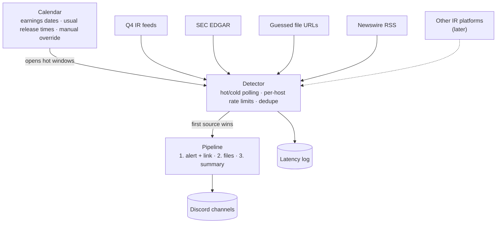

# Architecture

This is a living document. Sections marked **Open** haven't been decided yet.

## Goal

Post a company's earnings to Discord before anyone else does, then follow up with the release
files and a formatted summary of the numbers.

## Overview

## Release detection

### What we measured

Data pulled on 2026-10-30, covering up to nine quarters per company:

- **IR release time:** the publish time in the company's investor relations (IR) feed
- **8-K accepted:** SEC EDGAR's acceptance timestamp
- **File upload time:** the `Last-Modified` header of the release PDF on the IR site's file CDN

| Ticker | IR platform | Fastest source | 8-K accepted after IR release | Release PDF uploaded after IR release |
|---|---|---|---|---|
| AMZN | Q4 | IR site (9/9 quarters) | median 12m17s (4m27s–24m12s) | 2m42s–13m36s |
| GOOGL | Q4 | IR site (5/5) | median 36s (33s–48s) | 56s–1m12s |
| MA | Q4 | IR site (9/9) | median 3m09s (1m49s–4m03s) | 23s–2m07s |
| UBER | Q4 | IR site (8/8) | median 1m12s (52s–1m58s) | 17s–29s |
| META | Q4 | IR site (9/9) | median 3m34s (2m23s–11m00s) | 8m12s–29m28s |
| SPGI | Q4 for the investor site; releases go out through a PR Newswire newsroom | SEC 8-K (9/9) | 8-K comes **5m38s–14m40s before** the IR site | 48s–6m29s *before* the IR site, but still after the 8-K |
| FICO | Not Q4; the site blocks automated access | Business Wire, which publishes at 4:15:00 PM ET | median 1m13s after the 4:15 PM release (26s–4m45s) | n/a (file URLs are random IDs on the blocked site) |

What this tells us:

- **The IR site is usually first**, often by minutes. EDGAR itself is fast (the submissions API
  updates about a second after a filing is published), but companies file the 8-K after the
  press release is out.
- **Not always.** S&P Global's 8-K beats its own IR site every quarter. We have to run every
  source and take whichever fires first.
- **The newswire is as fast as the IR site.** Business Wire's earnings feed lists Amazon's Q3
  release at 4:01:00 PM ET, the same minute as the IR feed. For FICO, whose IR site we can't
  reach, the newswire is the fastest source.
- **Release PDFs usually go up after the release page.** So guessing file URLs mostly helps us
  collect files sooner, and only sometimes detects a release first.
- For comparison, Wall St Engine's full posts came 2m14s (AMZN), 4m25s (MA) and 6m35s (GOOGL)
  after the IR release in Q3 2026.

### Sources

1. **Q4 IR feeds.** The main source for companies whose IR site runs on Q4 Inc. Q4 sites expose
   undocumented JSON feeds under `/feed/`:
   - `PressRelease.svc/GetPressReleaseList`: detects the release
   - `Event.svc/GetEventList`: earnings call dates (for the calendar) and attached files
   - `FinancialReport.svc/GetFinancialReportList`: the release, slides, supplemental data and 10-Q for each quarter

   Feed timestamps use each site's local time zone, and that isn't consistent even within one
   site. We use our own clock.
2. **SEC EDGAR.** The fallback for every company, and the main source for S&P Global, whose IR
   site trails its 8-K. We poll `data.sec.gov/submissions/CIK##########.json` for new 8-Ks
   with item 2.02. SEC allows at most 10 requests per second across everything we send it, and
   requires a User-Agent with a name and contact email (`SEC_USER_AGENT` in `.env`).
3. **Guessed file URLs.** File names follow per-company patterns that we learn from past
   quarters, for example:
   - `AMZN-Q{q}-{yyyy}-Earnings-Release.pdf`
   - `Uber-Q{q}-{yy}-Earnings-Press-Release.pdf`
   - `{yyyy}q{q}-alphabet-earnings-release.pdf`

   During a hot window we probe the likely URLs with `HEAD` requests. When a pattern has varied
   in the past (Meta's `_FINAL` vs `-FINAL`, Mastercard's folder change) we probe each variant.
   The file CDN doesn't cache 404s, so probing before a file exists can't leave a stale copy.
4. **Newswire RSS.** Business Wire's Earnings News feed
   (`https://feed.businesswire.com/rss/home/?rss=G1QFDERJXkJeEF9YXA==`) carries about 220
   releases a day, and each `pubDate` is the release minute. We match items to tracked companies
   by name. It's the main source for FICO. The feed allows caching for up to 5 minutes
   (`s-maxage=300`), so how quickly it refreshes still needs measuring. PR Newswire's earnings
   feed (`https://www.prnewswire.com/rss/financial-services-latest-news/earnings-list.rss`) is
   read the same way for companies that use it: a schedule entry lists their names under
   `prnewswire`. Its items also name the company in `dc:contributor`, which is matched too.
   The same source reads company press release feeds, such as the ones Equisolve sites publish.
5. **Later:** adapters for other IR platforms.

### IR platforms

How often is a company's IR site something other than Q4? We checked 36 widely followed
companies on 2026-10-30, plus the seven above, by probing the Q4 feed and reading each site's
DNS records:

| Platform | Companies | Automated access |
|---|---|---|
| Q4 | AAPL, NVDA, NFLX, ORCL, CRM, PLTR, COIN, V, PYPL, COST, SBUX, BA, ABNB, SNOW, MU, QCOM, DIS, plus AMZN, GOOGL, MA, META, UBER, SPGI | JSON feeds work |
| Equisolve | AMD, INTC, BAC, WMT, KO, NKE | Pages load. AMD, Intel, Coca-Cola and Nike have a press release RSS feed at `/news-events/press-releases/rss`; Walmart and Bank of America don't |
| Notified (`*.gcs-web.com`) | FICO, CRWD, LLY | Blocked by Akamai (403) |
| Investis | HD | Blocked (403) |
| The company's own site | MSFT, ADBE, GS, JPM, UNH, TGT | Pages load, with no common feed |
| Unknown, blocked | TSLA, AVGO, MCD | 403 or timeout |

- **Q4 is about half** (23 of the 42 in the table), so it stays the first IR adapter. Disney
  was first counted as blocked, because `thewaltdisneycompany.com/investor-relations/` returns
  403. Its IR site is really `investors.thewaltdisneycompany.com`, on Q4, which works.
- **Equisolve is next**, and its RSS feeds already work with the newswire source.
- **About one in six sites block automated access** (7 of 42). Those companies are covered by
  newswires and EDGAR, the way FICO is.

### Companies off Q4

Checked on 2026-10-31 for the 19 companies in the table that aren't on Q4, plus S&P Global.
Each row gives the fastest source we can read and how far it led the 8-K. Where a range is
given, the source's time held for the quarters we could see. A single number comes from the
latest quarter only. The details per company, with the last four 8-K times, are in
`src/earnings_bot/companies.toml`.

| Fastest source we can read | Companies | Lead over the 8-K |
|---|---|---|
| The company's RSS feed (Equisolve) | AMD 4:15 PM, Intel 4:01 PM, Coca-Cola 6:55 AM, Nike 4:15 PM | AMD 1 min, Intel 6–10 min, Coca-Cola 3–5 min, Nike only 15–28 s |
| PR Newswire | Lilly 6:45 AM, Home Depot 6:00 AM, Target 6:30 AM, McDonald's 7:00 AM | Lilly 18 min, Home Depot 10 min, Target 81 min, McDonald's 1.5 min |
| A company page at a predictable URL | UnitedHealth 5:55 AM, with Business Wire the same minute | 19 min |
| Business Wire | FICO 4:15 PM, Adobe 4:05 PM, CrowdStrike 4:05 PM | FICO median 1m13s, Adobe 1 min, CrowdStrike 2 min |
| SEC 8-K | S&P Global, Walmart, JPMorgan, Bank of America, Broadcom, Tesla | S&P Global's 8-K beats PR Newswire by 6–11 min. Walmart's beats its own newsroom by about a minute and Business Wire by two. JPMorgan's beats Business Wire by 38 min |
| Not known yet | Microsoft, Goldman Sachs | |

- **Which wire a company uses varies, and it isn't always Business Wire.** AMD and NVIDIA use
  GlobeNewswire, whose RSS feed returns 403 to us, so their own feeds are the way in. Lilly, Home
  Depot, Target, McDonald's and S&P Global use PR Newswire. UnitedHealth, Salesforce, Walmart,
  JPMorgan, Adobe and CrowdStrike use Business Wire. Bank of America, Goldman Sachs, Broadcom,
  Microsoft and Tesla use none.
- **A wire can trail the 8-K badly.** JPMorgan's 8-K was accepted at 6:30 AM, and Business
  Wire posted its release at 7:08 AM. Its release PDF was uploaded at 5:15 AM under a random
  name. The quarterly-earnings page that links it answers us, so watching that page might beat
  the 8-K.
- **Release files on blocked sites mostly come after the wire.** By their `Last-Modified`
  stamps, Lilly's PDF went up 2 minutes after PR Newswire, Home Depot's 5 minutes after it, and
  CrowdStrike's 2 minutes after its 8-K. McDonald's is the exception: its PDF was uploaded at
  6:46 AM, 14 minutes before the 7:00 AM release, but that host refuses automated requests.
- **PR Newswire is a source,** for Lilly, Home Depot, Target, McDonald's and S&P Global. Its
  earnings feed holds the latest 20 earnings releases, so it's polled every 2 seconds: twenty
  items can turn over within a minute at 4 PM on a busy day. Its CDN keeps a copy for up to 60
  seconds and ignores cache-busting parameters (a fresh URL came back as a cache hit 38 seconds
  old), so there's no busted copy to poll. Live data will show how much of that minute it costs.
- **Some own sites have predictable URLs** for the release page or PDF: UnitedHealth, Target,
  Walmart, Goldman Sachs and Microsoft. These are guess templates in `companies.toml`. Others
  name files by random IDs: JPMorgan, Bank of America, and Walmart's PDFs.
- **Tesla is the biggest gap.** It uses no wire, and its update deck sits on hosts that block
  automated requests: `ir.tesla.com`, and the deck's own host `assets-ir.tesla.com` (both Akamai
  403). That holds even though the deck's name is predictable (`TSLA-Q3-2026-Update.pdf`). So
  the 8-K is the first source we can read. It came at 4:35 and 4:41 PM in the last two quarters,
  and 4:06 to 4:14 PM before that.
- **Blocked sites stay blocked.** For FICO, CrowdStrike, Lilly, Home Depot, Broadcom, McDonald's
  and Tesla, a person can check by hand how early the site posted, using
  [manual checks](manual-checks.md). The bot itself never reads those sites.

### How fresh feeds are

Every company feed we read stamps the release with its release minute: AMD 4:15:00 PM, Intel
4:01:00 PM, Coca-Cola 6:55:00 AM, Nike 4:15:00 PM and Target 6:30 AM. That's the same minute as
the wire and the release page. But a stamp is the time the release was scheduled for, not proof
the item was in the feed at that second. How stale a copy can be depends on caching.

On 2026-10-31 we sent each feed three requests: a plain one, one with a cache-busting query
parameter, and one with `Cache-Control: no-cache`. A slower answer, a `MISS`, or no `age` means
the request reached the origin:

| Feed | Caching | Does busting reach the origin? |
|---|---|---|
| Q4 JSON feeds | 10 s | Yes |
| Business Wire RSS | 300 s at the CDN | Yes: the busted request took 389 ms against 101 ms. But the origin itself returned a build nine hours old (on a Saturday), so it may lag on its own |
| PR Newswire RSS | 60 s (Cloudflare) | No: busted and `no-cache` requests were both cache hits, 47 s old |
| Intel's RSS feed | 30 s plus stale-while-revalidate (CloudFront) | No, and one copy was 113 s old |
| AMD's RSS feed | No cache headers, but CloudFront caches it anyway | No |
| Coca-Cola's RSS feed | CloudFront | Yes: the busted request was a `MISS` |
| Target's press release feed | A copy 2.2 hours old | No. Useless for speed; PR Newswire carries Target |

`no-cache` made no difference anywhere. What we can do about the rest:

- **Business Wire:** the bot already polls a busted and a plain copy. Nov 2 and Nov 4 show
  whether the origin lags.
- **PR Newswire:** its cache can't be skipped, but its feeds keep separate 60-second timers. At
  one moment, 18 of its feeds had last refreshed at times spread over a minute. Reading two or
  three feeds that carry the same release, such as the earnings feed, the company's industry
  feed (Health for Lilly, Consumer Products & Retail for Home Depot and Target) and the all-news
  feed, cuts the typical delay from about 30 seconds to about 15. The worst case stays at 60.
- **Equisolve feeds behind CloudFront:** the delay is whatever the CDN keeps. AMD on Nov 3
  measures it. The wire is the backup for Intel, Coca-Cola and Nike.
- **Guessed pages:** a site has to answer a missing page with a real 404, and not cache it for
  long. Goldman Sachs sends `no-store`, which is ideal. Target caches its 404s for an unknown
  time and ignores busting. UnitedHealth answers 200 with a "Page Not Found" page, a soft 404,
  even for PDFs, which would read as found. So its guesses stay out of schedules
  (`soft_404 = true` in `companies.toml`) until the bot checks what it got back.

Live runs will measure the real delay: Nov 2 (Palantir and Apple: Business Wire against Q4 and
Apple's newsroom), Nov 3 (AMD: its RSS feed against the 8-K) and Nov 4 (Uber and FICO: Business
Wire against Q4 and the 8-K).

### Scheduling

- **Calendar.** [Report dates](#report-dates) covers where dates come from. Each company's past
  release times tell us when in the day to look: Amazon has used 4:01:00 PM ET for nine straight
  quarters, Uber 6:55:00 AM ET, and FICO 4:15:00 PM ET.
- **Hot window.** Starts a few minutes before the expected release and runs until the release is
  detected or the window times out. Each source is polled about once a second, and once every
  few seconds for newswire RSS, which serves every company from one URL. IR feeds get a
  cache-busting query parameter, because their CDN can otherwise serve a copy up to 10 seconds
  old. We cap this at one request per second per company.
- **Cold polling.** Outside hot windows, every source is polled every few minutes to catch
  unscheduled or early releases.
- **Rate limits are per host and shared across companies.** On a busy evening, a dozen companies
  report at 4 PM and all of them share SEC's 10 requests per second. See
  [Sharing SEC's limit](#sharing-secs-limit).
- **Connections stay open** (HTTP keep-alive / HTTP/2), so polls don't pay for a new TLS
  handshake.

### From detection to Discord

- The first source to fire triggers the pipeline. Later sources are merged into the same
  release by (ticker, fiscal period) and only add what's missing, such as more files.
- Posting happens in stages: an alert with a link within seconds, then files as they appear,
  then the summary.
- Each step logs two times after the first sighting. `live_seconds` comes from Discord's own
  timestamp on the message or edit, which is when people could see it. `seconds` is when
  Discord's reply reached the bot. They differ when discord.py waits out a rate limit before
  returning. In tests on 2026-10-30, Discord answered every request in 0.1 to 0.6 seconds, and
  every multi-second wait came from discord.py's rate limiter: about 4 seconds on reads, once a
  bucket ran out. In one replay, Discord stamped the alert 0.12 seconds after the sighting, but
  the reply reached the bot only at 2.54 seconds.
- Every source records when it first saw each release. This latency log shows which source
  wins for each company and lets us compare against public timestamps such as X posts.
- Until the detector exists, `earnings-bot-record` takes the same measurements for scheduled
  releases. It polls every source during a window around the expected time. The first run is
  November 2, 2026: Palantir at 4:05 PM ET and Apple at 4:30 PM ET.

### Ground rules

- Identify ourselves honestly in the User-Agent. Stay within the rate limits, and back off when we
  get errors.
- If a site blocks automated requests, cover it through EDGAR and newswires. We don't try to get
  around the block, whether by faking a browser User-Agent or by scripting a real browser.
  FICO's IR site is behind Akamai bot protection, and even its `robots.txt` returns 403.

## Tracking companies

Designed on 2026-10-31, to be built after the November 4 test. Until then the bot watches a
hand-written schedule file. Schedule files stay afterwards, for tests and replays. The build
order is part of the automation plan in [Running unattended](#running-unattended).

### What SEC's data gives us

Checked on 2026-10-31:

- **SEC's ticker list** (`company_tickers.json`) has 10,423 tickers, each with its CIK.
- **SEC's `website` and `investorWebsite` fields** were empty for all seven companies in the
  table below.
- **Earnings 8-Ks are filed at the same time of day every quarter** (table below).
- **The press release filed with the 8-K (EX-99.1) often names the IR site.** Of eight we read,
  four name it outright (investor.apple.com, investors.palantir.com, investors.nike.com,
  ir.crowdstrike.com) and three name only the main site (fico.com, amd.com, microsoft.com). Our
  check found no site in Amazon's.
- **Few releases say which newswire carried them.** Three of the eight have a Business Wire
  dateline (PLTR, FICO, AMZN). The other five name no wire.

Acceptance times of the last five earnings 8-Ks:

| Ticker | 8-K accepted (ET) |
|---|---|
| AAPL | 4:30 PM all five times |
| PLTR | 4:06–4:07 PM |
| UBER | 6:56 AM all five times |
| FICO | 4:15–4:19 PM |
| SPGI | 7:10–7:15 AM |
| AMD | 4:16 PM all five times |
| MSFT | 4:03–4:07 PM |

### What `/track` works out

`/track TICKER` starts from `src/earnings_bot/companies.toml` when the company is in it. That
file holds what we've already checked for 42 companies: CIK, platform, which wire, feeds, URL
templates, recent 8-K times and the fastest source. Until `/track` exists,
`uv run python -m earnings_bot.known TICKER TIME --fiscal-year YYYY --quarter Q` prints a
schedule entry from it. For any other company, `/track` fills in everything a schedule file
holds today:

- **CIK and name** from SEC's ticker list. A ticker that isn't on it is rejected.
- **IR site.** We use the IR host named in the last earnings release. If it names only the main
  site, we try `investor.`, `investors.` and `ir.` in front of it. Each candidate is probed for
  Q4's feeds and for Equisolve's press release RSS feed. A site that blocks us, like FICO's, is
  left out, and the company is covered by EDGAR and the newswires.
- **Names to match on newswires.** The SEC name without suffixes such as Inc. or Corp., plus the
  name in the company's own release headlines. Fair Isaac files with SEC as "FAIR ISAAC CORP",
  but its headlines say "FICO". Since few releases name their wire, every newswire feed is
  matched against every company. Each feed is one URL for all companies, so this costs a few
  requests, not a few per company.
- **File patterns.** On Q4 sites, the last three quarters' file names from the financial reports
  feed. When they follow one pattern, the bot guesses next quarter's URLs. When they don't, it
  doesn't guess.
- **Time of day** from past 8-K acceptance times.

The reply lists what was found and what wasn't. Optional `ir_site`, `date` and `time` arguments
fill in or correct what the lookup missed.

### Report dates

We don't use a calendar service. FMP's free plan returned only 12 companies for November 1–6,
2026, and we chose not to add another provider. Dates come from these sources, most trusted
first:

1. A date and time given in `/track`
2. The Q4 events feed, which lists the next earnings call
3. The company's date announcement. Most companies put one out two to four weeks ahead: FICO
   announced its November 4 date on October 21. The bot looks for these in sources it already
   polls, meaning the company's IR or RSS feed and newswire items matched to it. It reads the
   date, plus either a time or "before the market opens" or "after the market closes".
4. An estimate: the same quarter's date a year earlier, from EDGAR. Estimated dates get no hot
   window, so cold polling catches the release, a few minutes later. `/upcoming` marks the date
   as estimated so someone can fix it.

Every morning the bot refreshes the dates and builds that day's hot windows. A window opens 30
minutes before the earliest of the last four 8-K times and closes 30 minutes after the latest,
because the release can come well before the 8-K (up to 24 minutes before, for Amazon). When an
announcement or `/track` gives a time, the window goes around that time instead, the same way a
schedule file's expected time does today.

### Commands and limits

| Command | Who can use it | What it does |
|---|---|---|
| `/track TICKER` | Anyone, up to 5 a day each | Starts tracking, with optional `ir_site`, `date` and `time` |
| `/untrack TICKER` | Members with Manage Server | Stops tracking |
| `/tracked` | Anyone | Lists the tracked companies |
| `/upcoming` | Anyone | Who reports in the next 7 days, and when |

- At most 50 companies are tracked at once.
- Changing a company that's already tracked (its date, time or IR site) also needs Manage Server,
  so nobody can quietly move another company's window.
- `/untrack` is registered with Manage Server as its default permission, so other members don't
  see it. Server admins can change that under Server Settings → Integrations.

### One server per copy

Each copy of the bot serves one server and posts to one channel (`DISCORD_GUILD_ID` and
`DISCORD_CHANNEL_ID`). Other people run their own copy from this repository, with their own SEC
contact and their own share of SEC's limit. If the bot is added to another server, it leaves.
Turning off **Public Bot** in the Developer Portal stops other people from adding it at all.

### Storage

A SQLite file holds:

- each tracked company and what `/track` found
- its next date, and where that date came from
- who added it and when, for the daily limit
- each release's Discord message, so a restarted bot keeps editing the same post instead of
  posting a second alert

### Sharing SEC's limit

With up to 50 companies, a busy evening can put a dozen or more in the same window. When n
companies' windows overlap, each one's SEC poll runs every n/8 seconds (never more than once a
second), which keeps us under SEC's 10 requests per second. EDGAR's list of the latest filings
would cover every company in one request. We'll measure how quickly it updates before relying
on it.

## Posting and summaries

One Discord message per release, edited as more arrives:

1. **Alert.** The first source to show the release triggers a post with its link and the time
   it was first seen. Later sources add their links.
2. **Files.** Release PDFs (guessed URLs, the IR site's file list) are downloaded and attached.
3. **Summary.** The first source that can supply the full text starts the summary, which is
   edited in as an embed (up to 4,096 characters, against 2,000 for plain text).

Where the text comes from:

| Source | Text | Notes |
|---|---|---|
| Q4 press release feed | The full release HTML, from the same feed with `bodyType=1` | Ready the moment the release is detected |
| SEC 8-K | The press release exhibit (EX-99.1), found through the filing's `index.json` | About a minute later for most companies; at the same time for Apple |
| Guessed or newsroom pages | The page itself | Apple's newsroom |
| Business Wire | None | Its article pages drop automated requests |

The summary comes from Claude (`claude-opus-5-5`, effort `medium`). It gets the release text,
consensus EPS and revenue from Financial Modeling Prep's earnings calendar, and a style guide
written for this project, with a made-up example rather than copies of anyone's posts. Claude
picks the KPIs that matter for each company. The bot then checks every number in the summary
against the release, allowing for rounding and for tables stated in thousands or millions, and
lists any it can't find in the embed's footer.

**Open.** Estimates for KPIs beyond EPS and revenue, and how fast the summary can get without
losing accuracy (effort `low`, or a smaller model).

## Running unattended

The plan for the bot to run day after day without anyone starting it, written on 2026-10-31.
It runs on the owner's Windows PC, not on a paid server. CI still builds the Docker image for
anyone who'd rather host it. Tracked companies, dates and posts go in a SQLite file (see
[Storage](#storage)), and the latency log stays a JSONL file.

### On the owner's PC

- **It starts itself.** A Task Scheduler task runs `scripts/run-bot.ps1` when Windows starts.
  The script loops: update if asked to, run the bot, and if the bot exits, wait 30 seconds and
  start it again. Task Scheduler restarts the script itself if that dies. Running the task "when
  Windows starts" rather than "at log on" means it comes back after an overnight update restart
  without anyone logging in. Windows asks the owner for their password once, when the task is
  saved.
- **It updates itself.** Once a day, at an hour with no window coming up, the bot checks whether
  `main` has new commits whose CI passed. If it does, the bot exits with a code the script reads
  as "update": `git pull --ff-only`, `uv sync`, then start again. Merging a PR is the deploy.
- **The PC stays ready.** Its power plan already never sleeps. In busy report weeks, pause
  Windows Update, or set its active hours to cover 6 AM to 6 PM Eastern.
- **Time and secrets stay as they are:** network time through `TrustedClock`, keys in `.env`.

**Open.** What to do about a release the bot missed while the PC was off or offline: post it
late, marked as late, or only note the gap in the status channel.

### Status messages

These go to a separate channel, such as `#bot-status`, so `#stocks` only gets releases:

- started, stopped and updated (with the commit)
- each morning, the day's windows
- problems: a source failing for a whole window (403s, timeouts), a window closing with nothing
  seen, or a Discord post failing
- after each window, which source saw the release first and by how much

If the PC is off, nothing can post. Discord still shows the bot as offline, which is the one
signal that doesn't need the bot running.

### Daily planner

Each morning at 5:00 AM Eastern, and at startup, the bot builds the day's windows from the
tracked companies and their [report dates](#report-dates), the way a schedule file does today.

### Learning from each release

After a window closes, the bot stores which source saw the release first, when, and how far
ahead of the 8-K. Those update the company's stored notes (fastest source, usual release
minute), so windows and source choices follow what actually happens. Changes worth keeping in
`companies.toml` come back as a PR.

### Build order

This starts after the Nov 2–4 runs, whose results feed into it.

0. **Read the Nov 2–4 logs.** Check Business Wire's real delay, AMD's feed, whether the window
   sizes were right, and how Discord held up. Update `companies.toml` and this doc.
1. **Fix what the 2026-10-31 checks found.** Guesses need to recognize a soft 404 by checking
   the content type, and the title for pages. Then UnitedHealth's guesses can go back in. PR
   Newswire should be read from two or three feeds per company.
2. **Run unattended:** `scripts/run-bot.ps1`, the Task Scheduler task, the status channel and
   self-updates. From here the bot is always on, still fed by schedule files.
3. **Storage, the daily planner, and `/track` for companies already in `companies.toml`,** with
   the date and time given in the command. Add `/tracked` and `/untrack` too. Schedule files
   become optional.
4. **Find dates automatically:** the Q4 events feed, date announcements and estimates, plus
   `/upcoming`.
5. **`/track` for any company,** researching it the way it was done by hand on 2026-10-31.
6. **Scale:** share SEC's limit across overlapping windows, and learn from each release.

## Decision log

| Date | Decision |
|---|---|
| 2026-10-29 | Python 3.13 with discord.py; uv, ruff, pyright and pytest; CI on GitHub Actions; Docker image on GHCR |
| 2026-10-30 | Run every source in parallel and take the first to fire. Q4 IR feeds are the main source, with SEC EDGAR as the fallback for every company |
| 2026-10-30 | Bust the CDN cache on IR feeds during hot windows, at most one request per second per company |
| 2026-10-30 | Add guessed file URLs as a source, probed during hot windows |
| 2026-10-30 | `/track` adds companies without an approval step |
| 2026-10-30 | Each deployment sets its own SEC contact through `SEC_USER_AGENT` |
| 2026-10-30 | Add newswire RSS as a source (Business Wire's earnings feed first). It's the main source for FICO, whose IR site blocks automated access |
| 2026-10-30 | Measure every source live with a latency recorder before building the detector, starting with Uber and FICO on 2026-11-04 |
| 2026-10-30 | Post one message per release and edit it: alert with links, then files, then the summary as an embed |
| 2026-10-30 | Write summaries with the Claude API (`claude-opus-5-5`) and check their numbers against the release. Consensus estimates come from Financial Modeling Prep |
| 2026-10-30 | Until `/track` exists, the bot watches the releases in a schedule file, the same format the latency recorder uses |
| 2026-10-31 | `/track` works out each company's CIK, IR site, newswire names, file patterns and usual time of day by itself, from SEC's data and the company's last earnings release |
| 2026-10-31 | Report dates come from `/track`, the Q4 events feed and the companies' own date announcements. No calendar service. Estimated dates get no hot window |
| 2026-10-31 | Anyone can `/track`, up to 5 companies a day each and 50 in all. `/untrack` and changes to a tracked company need Manage Server |
| 2026-10-31 | One server and one channel per copy of the bot |
| 2026-10-31 | Keep tracked companies, dates and posts in SQLite |
| 2026-10-31 | Keep what we've researched about each company in `companies.toml`, checked into the repository, for `/track` to start from |
| 2026-10-31 | Add PR Newswire's earnings feed as a source for the companies that use it, matched on headline, dateline and `dc:contributor` |
| 2026-10-31 | Run the bot on the owner's Windows PC, started by Task Scheduler and updated from `main`, not on a paid server |
| 2026-10-31 | Leave guesses out of schedules for sites that answer missing pages with 200, until the bot checks what it got back |
