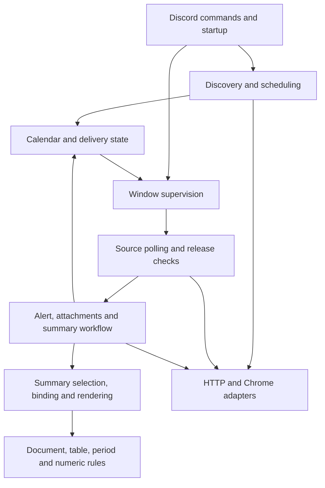
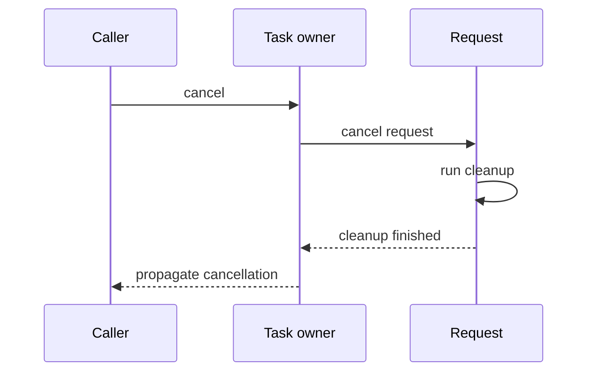

# Python quality review before 1.0

Added November 16, 2026. This is a review standard and an initial findings register.
The gate is **open**. Passing the linters is one input; it does not complete the review.

The baseline is `ca9d3f33c9aecdd894dfb49d67262602e7843537` (v0.21.48).
Claude is changing verified summaries concurrently. Review that code again at its final
merged revision before signing off; do not reorganize its files during that work.

## Conventions and their sources

These are project decisions informed by the references below. Python does not prescribe
one application architecture, a maximum function length, or a target comment percentage.

| Area | Convention for this project | Reference |
|---|---|---|
| Readability | Keep the configured 100-character format. Use descriptive names, straightforward control flow and small cohesive operations. Shorten code when that improves comprehension. | [PEP 8](https://peps.python.org/pep-0008/), [PEP 20](https://peps.python.org/pep-0020/) |
| Comments | Delete narration of visible operations and stale development notes. Keep reasons, external constraints, units and invariants. Move long incident accounts to linked docs. Rename confusing code before adding explanatory narration. | [PEP 8 comments](https://peps.python.org/pep-0008/#comments) |
| Docstrings | Explain a module's responsibility and the contract of meaningful public operations: inputs, result, side effects, errors and ownership where relevant. Avoid repeating the signature in prose. | [PEP 257](https://peps.python.org/pep-0257/) |
| Structure | Keep `src/first_print`, `tests`, `scripts`, `docs` and `pyproject.toml`. Group modules when they share a responsibility and a clear interface. | [PyPA layout discussion](https://packaging.python.org/en/latest/discussions/src-layout-vs-flat-layout/) |
| Types | Describe internal data precisely; validate untrusted data at entry. Use `Any` deliberately at JSON/SDK boundaries. Prefer a small named record or protocol when it clarifies an actual contract. | [Python typing](https://docs.python.org/3.13/library/typing.html), [typing best practices](https://typing.python.org/en/latest/reference/best_practices.html) |
| Async ownership | Give every task an owner, observe failures and finish cleanup. Propagate cancellation after cleanup. Use a task group for related tasks with a shared lifetime when its failure behavior fits. | [Python 3.13 asyncio](https://docs.python.org/3.13/library/asyncio-task.html#task-cancellation) |
| Resources | Make the lifetime of clients, files, connections and Chrome processes explicit. A SQLite transaction context does not close the connection. | [SQLite contexts](https://docs.python.org/3.13/library/sqlite3.html#how-to-use-the-connection-context-manager) |
| Failure reporting | Give recoverable failures an observable outcome. Catch broadly at a deliberate isolation boundary, with logging, a recorded error or a documented fallback. | [Logging HOWTO](https://docs.python.org/3.13/howto/logging.html) |
| Tool exceptions | Keep type/lint suppressions specific and justified. Remove obsolete suppressions; Ruff already enables the relevant unused-`noqa` check. | [Ruff RUF100](https://docs.astral.sh/ruff/rules/unused-noqa/) |

Use the existing vocabulary consistently: an issuer, release, source, watch, window, sighting
and delivery represent different things. Name durations with their units and distinguish
monotonic elapsed time from timezone-aware publication time.

An abstraction should make an existing responsibility easier to locate and test. A helper
used once can clarify a substantial phase; a generic framework for hypothetical future
sources needs a demonstrated benefit. Keep policy decisions visible at the workflow level.

### Published code worth studying

These are concrete examples, pinned to releases rather than moving branches:

- [HTTPX 0.28.1 transport interface](https://github.com/encode/httpx/blob/0.28.1/httpx/_transports/base.py):
  a small transport boundary and explicit resource lifetime. Apply that idea to the bot's
  HTTP/Chrome boundary; there is no need to switch HTTP libraries to learn from it.
- [Click 8.1.8 package interface](https://github.com/pallets/click/blob/8.1.8/src/click/__init__.py)
  and [project configuration](https://github.com/pallets/click/blob/8.1.8/pyproject.toml):
  explicit exports, separate implementation modules, `src` packaging and warnings-as-errors.

Borrow the relevant design decisions. These projects also have different compatibility
requirements and large modules; their directory trees are examples, not universal rules.

## Structure and ownership

The current root layout is appropriate:

```text
first-print/
  pyproject.toml             package, dependencies and tool settings
  src/first_print/          application and its domain-specific modules
  tests/                    behavioral tests, shared fakes, fixtures and replays
  scripts/                  maintenance, evaluation and Windows operations
  docs/                     architecture, operator guidance and dated evidence
  schedules/                declarative watch and trial plans
  .github/workflows/        CI, image builds and scheduled checks
```

This diagram groups existing responsibilities. The boxes are conceptual areas, not a claim
that these subpackages already exist. Arrows show calls or use of data.



Prefer extracting a cohesive responsibility before moving folders. For example, date
interpretation can be separated from scheduling and cache preparation without changing
all imports at once. A `summaries/` package may eventually make that family easier to
navigate after Claude's changes settle. Keep compatibility imports where callers need them.
Avoid a growing catch-all `utils.py` or a one-class-per-file policy.

### Resource lifetime to verify

For a request owned by a caller, cancellation should leave a known owner until cleanup ends.
If cleanup intentionally outlives the caller, a longer-lived supervisor must retain it.



Shared downloads have a different lifetime: cancelling one reader must preserve work another
reader needs. Their owner still has to drain the worker when the release finishes.

## Initial scan and findings

The read-only AST inventory covered all **156 tracked Python files**: 69 application modules,
81 test/replay modules and six maintenance scripts. Application files contain 23,282 physical
lines and 1,168 comment tokens. These are measurements, not quality thresholds.

Ruff, formatting and Pyright pass on the baseline. The inventory found no mutable function
defaults and no cycles among the statically resolved eager application imports. It excludes
`TYPE_CHECKING` edges and distinguishes deferred imports; dynamic imports need manual review.
The existing test cleanup is recorded separately in [the test audit](test-audit/README.md).

This is whole-tree mechanical coverage plus targeted manual inspection, not a completed
line-by-line sign-off of every module.

| Finding | Evidence and recommended action | Priority / status |
|---|---|---|
| A cancelled scorecard caller can leave request cleanup running without its owner waiting | [`EditPriority.card`](../src/first_print/edit_priority.py) cancels in `finally` and drops the task from `_cards` without awaiting its completion. A gated async cleanup probe reproduced a completed caller with a still-pending request. Drain it with an appropriate cleanup deadline, or give its remaining cleanup an explicit supervisor. Preserve alert priority and add one regression that fails on this behavior. | Required resolution before sign-off; reproduced, not fixed by this docs change |
| Discovery combines several responsibilities | `date_discovery.py` is 1,475 lines. `_check` selects evidence, formats missing-date status, prepares routes/cache and commits the plan. `investigate.py::investigate` spans 255 lines. Consider extraction by phase, preserving source precedence and deadline/untrack checks. Length selects review candidates; it does not mandate splitting. | Refactor candidate after behavior review |
| Delivery combines transport and orchestration | `pipeline.py` is 1,335 lines and contains Discord poster implementations and release orchestration. Review a poster-module extraction before changing the state machine. Preserve successful bytes, deduplication, edit priority and durable retry semantics. | Refactor candidate; compare release replays |
| Two deferred dependency pairs | The literal import graph contains `browser` / `fetch` and `text` / `wire_mirror` pairs. They do not form eager import cycles. A small response-type boundary and a pure report-validation boundary could remove those dependencies if this improves change isolation. | Design review; not a demonstrated runtime failure |
| Verifier structure is changing | The baseline's `_paragraph_binding` spans 244 lines and `_table_binding` 217. Assess naming, rule order, helper contracts and module grouping against the final summary revision. Re-run its negative controls and held-out evaluation after any extraction. | Review after Claude's work; no parallel edits |
| Client lifetime needs an explicit review | `bot.py::_watch` creates a summarizer; `Summarizer` creates an async SDK client also shared with profile preparation. Verify and document who closes that client on startup failure, normal exit and cancellation. No network leak has been measured by this scan. | Lifecycle review candidate |
| A few comments use old development vocabulary | `browser.py` still describes the worker as a Windows IR "trial"; evaluation scripts refer to "item 6". Update these descriptions to current responsibilities. Inspect obvious narration such as the sentence above `PROFILE_PREFIX`. | Small wording/deletion candidates |
| Important comments explain real constraints | Keep shared SEC pacing, oversized-header limits, encoded URL handling, Discord old-message limits, monetary units/period rules, and shared-reader cancellation explanations. | Keep; do not reduce comments by quota |
| Compatibility code is live behavior | `plan_migrations.py` handles saved schedules and persisted IR patterns. The `[target.trial]` name also remains a persisted format. Search readers and saved fixtures before removing or renaming them. | Keep unless a supported migration replaces it |

The cancellation probe held a request in its `finally` block with an event, cancelled the
caller and observed: caller complete, cleanup started, cleanup incomplete, request pending.
It then released and awaited the request, so the probe itself left no task behind. This
establishes the ownership gap, not a measured Discord outage.

The broad exception review must judge purpose. For example, PDF extraction deliberately
returns no text for damaged files; other boundaries record failures and allow unrelated
sources to continue. Replacing these with narrower catches solely to satisfy a style rule
could change recovery behavior.

## Scope and completion gate

Review all application modules, Python/PowerShell scripts, packaging, CI and the test
support structure. Reuse the recent test-pruning conclusions rather than repeat that work.
Keep international implementation separate from this review.

Record each area's decision as **keep**, **delete**, **refactor** or **defer with reason**:

1. Names, control flow and comments: remove stale narration; keep invariants and useful
   contracts; check that a new contributor can locate each responsibility.
2. Module boundaries: trace imports and state ownership; examine the large workflow functions
   above; remove dead paths only after checking dynamic callers, entry points and migrations.
3. Async and I/O: review every created task, cancellation path, timeout, retry, byte cap,
   browser/client lifetime and CPU-heavy parser's effect on the event loop.
4. Data contracts: inspect `Any`, casts, suppressions, mutable shared state, timezone/unit
   conversions, SQL parameters, persistence versions and provenance at external boundaries.
5. Operations: inspect startup failure, shutdown, restart recovery, safe file handling,
   secret redaction, meaningful error reports and installation/package contents.
6. Tests: preserve observable behavior and unique negative controls. Add tests for real
   uncovered behavior, not for comment edits, file moves or the chosen decomposition.

Close the gate when the following evidence is recorded at the reviewed revision:

- [ ] Every area above has a completed inventory and decisions, including the final verifier.
- [ ] Reproduced lifecycle/correctness findings are resolved and regression-checked, or an
  explicit existing ownership contract demonstrates why the reported behavior is intended.
- [ ] Each proposed structural change has a concrete benefit and a bounded implementation;
  optional redesigns have a documented deferral rather than blocking 1.0 indefinitely.
- [ ] Comments and docs describe current behavior; important quirks and compatibility
  requirements remain discoverable.
- [ ] Ruff, formatting, type checking and relevant tests pass on Linux and Windows.
- [ ] Changed polling/delivery code passes failure and burst replays. Changed binding code
  preserves known-wrong rejection and is measured on held-out releases.
- [ ] Architecture diagrams and the reading guide match the resulting implementation.

Use focused PRs: wording/dead-path cleanup, lifecycle fixes and module extractions are
independently reviewable changes. Report application, test and documentation deltas separately.
Do not introduce universal file-size caps, new strictness everywhere, or coverage targets
merely to produce a cleaner score.
